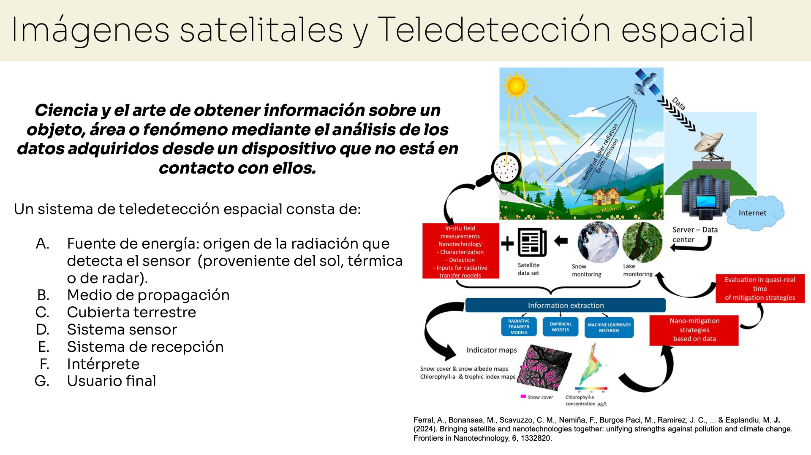
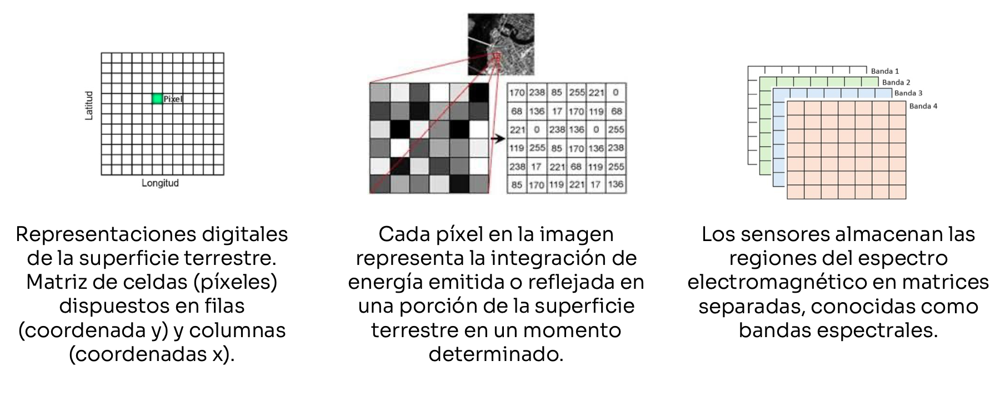
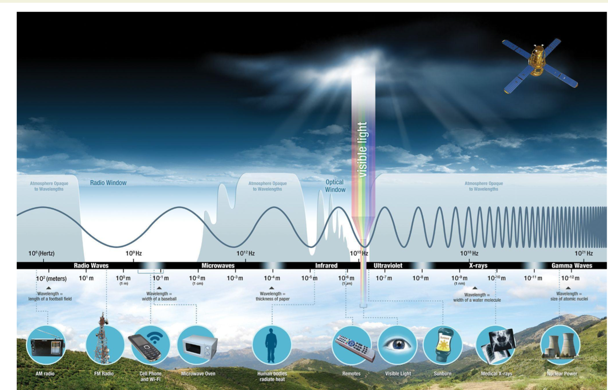
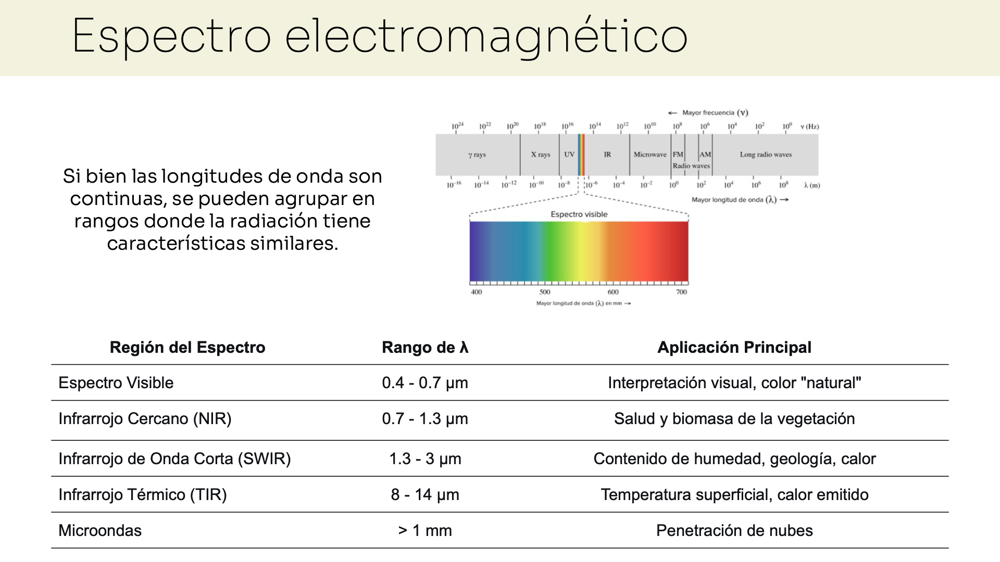
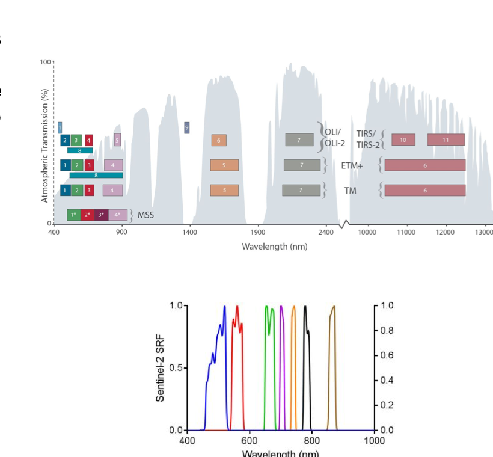
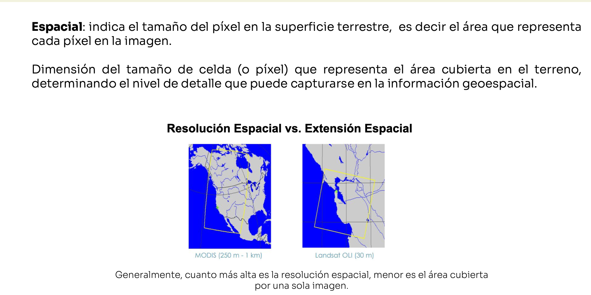
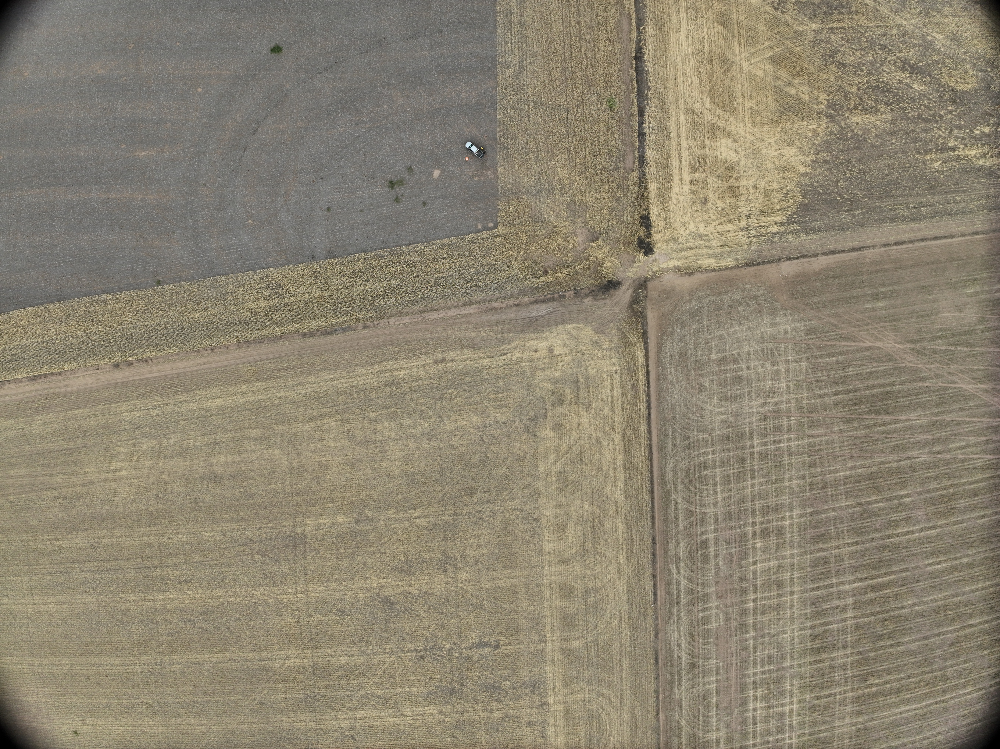
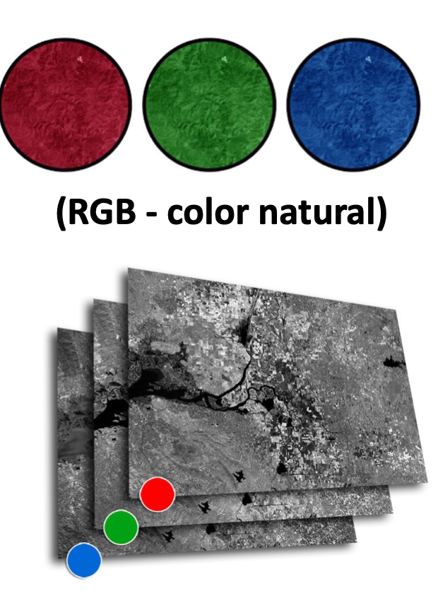
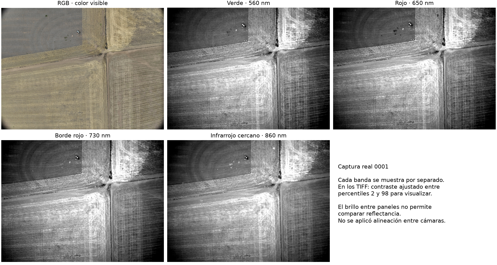

# Clase 1 — De la luz al píxel

Una imagen aérea parece una vista directa del terreno. En realidad, es el resultado de una medición: una señal llega a un sensor, se convierte en datos y se organiza para que podamos observarla. Entender ese recorrido ayuda a distinguir lo que una imagen muestra de lo que todavía hace falta comprobar.

## Observar sin tocar

La teledetección permite obtener información de una superficie sin medirla por contacto directo. En una captura habitual, la energía del Sol atraviesa la atmósfera, llega al suelo y a la vegetación, y una parte vuelve hacia el sensor. El sensor registra esa señal y la transforma en datos.



La superficie puede reflejar, absorber o transmitir la energía en distintas proporciones. La atmósfera también puede modificar la señal. Por eso, la imagen no es una copia de la realidad: es una medición tomada desde una posición, en un momento y con un sensor determinados. Para entenderla, necesitamos saber qué señal registró ese sensor y bajo qué condiciones.

## De la escena a los datos

La señal medida se organiza en una cuadrícula de filas y columnas. Cada celda es un píxel y contiene un valor que representa la medición en esa parte de la escena. Si en una celda coinciden suelo y vegetación, el píxel puede combinar la señal de ambos.



Una fotografía RGB contiene tres canales: rojo, verde y azul. En cada posición hay un valor para cada canal; al combinarlos en una pantalla vemos un color. Otros sensores registran más canales, asociados a diferentes rangos de energía. Cada canal forma una capa de valores sobre la misma cuadrícula.

El píxel es una unidad de la imagen digital. Su tamaño en la pantalla no indica por sí solo cuánto terreno representa.

## Del visible al espectro

El ojo humano percibe una parte pequeña de la radiación electromagnética: la luz visible. Los sensores pueden registrar también energía fuera de ese rango, como el infrarrojo cercano, el infrarrojo de onda corta, la radiación térmica o las microondas.





Los distintos rangos se relacionan con la longitud de onda. No hace falta memorizar sus valores para comprender la idea: una cámara común registra la luz visible, mientras que otros sensores pueden medir energía que no vemos directamente. Esa información puede ayudar a distinguir superficies que parecen similares en una fotografía común.

Una superficie no responde igual en todos los rangos. Dos materiales que se ven parecidos pueden reflejar cantidades distintas de infrarrojo. “Se ve verde” describe una apariencia visible; “refleja mucho infrarrojo” describe otra medición.

## Bandas: distintas ventanas de medición

Una banda es un intervalo de longitudes de onda que el sensor registra en un canal. Cada banda produce una capa de valores. Una cámara RGB registra tres bandas amplias del visible; un sensor multibanda puede sumar bandas de otras regiones; uno hiperespectral separa la energía en muchos intervalos más estrechos.



La resolución espectral describe cuánto detalle tiene un sensor al separar esos intervalos. Una banda amplia reúne señales de una porción mayor del espectro; varias bandas estrechas permiten observar diferencias dentro de esa porción. Esto puede aportar información adicional, pero no asigna automáticamente una categoría a cada píxel. Una banda no significa por sí sola “suelo”, “cultivo” o “maleza”: para interpretar los valores se necesita conocer qué mide cada canal, cómo se obtuvo la imagen y qué ocurre en el terreno.

Cada banda aporta valores para las mismas celdas. También importa cuánto terreno representa cada celda y qué detalles permite distinguir.

## ¿Cuánto terreno representa un píxel?

La resolución espacial expresa el nivel de detalle espacial de una imagen. Una forma sencilla de entenderla es preguntar qué superficie representa cada píxel. Si una celda cubre un área grande, los objetos pequeños quedan mezclados. Si cubre un área menor, pueden distinguirse detalles más finos, siempre que la captura y la calidad de la imagen lo permitan.




Las imágenes muestran cómo cambia la lectura al variar la escala: con una vista general se reconocen patrones amplios; con más detalle se distinguen elementos más pequeños. La cantidad de píxeles del archivo, por sí sola, no permite saber cuál de esas escalas representa.

Conviene separar tres conceptos:

- **Dimensiones digitales:** cantidad de píxeles a lo ancho y a lo alto del archivo.
- **Extensión:** superficie total que abarca la imagen.
- **Resolución espacial:** superficie que representa cada píxel y el detalle que puede distinguirse.

Una imagen puede tener millones de píxeles y cubrir una superficie extensa o pequeña. Para relacionar sus dimensiones con el terreno hacen falta datos de captura y geometría, como la altura, la óptica, la posición, la orientación y el procesamiento aplicado.

## Leer una imagen del campo

En esta fotografía RGB se observan patrones de parcelas, variaciones de color y textura y una vista amplia del terreno.



Los valores rojo, verde y azul de cada píxel también pueden observarse por separado. El [notebook de canales RGB](clase_01_demo_rgb.ipynb) conecta la matriz con un píxel concreto, muestra cada canal y prueba una máscara gruesa para comparar hileras con el camino.

El archivo mide 5280 × 3956 píxeles. Esas dimensiones describen su tamaño digital; no indican cuánto terreno cubre cada píxel. El color visible tampoco permite deducir por sí solo la ubicación precisa, la reflectancia calibrada, el cultivo o el estado de una planta. Para sostener esas afirmaciones se necesitan metadatos y contexto agronómico.

La vegetación que aparece en una imagen no queda identificada automáticamente como maleza. Puede tratarse de un cultivo, una cobertura sembrada, vegetación espontánea u otra condición. La imagen permite describir patrones; la identificación requiere evidencia adicional y conocimiento del terreno.

## Cómo se asignan las bandas a colores

En una composición RGB de color natural, las bandas roja, verde y azul se muestran en los canales de pantalla correspondientes. En una composición de falso color, una o más bandas se asignan a canales distintos. Por ejemplo, el infrarrojo cercano puede mostrarse en rojo.



El falso color depende de esa asignación: la composición representa las mediciones del sensor con otros colores en pantalla. En una composición frecuente, la vegetación aparece roja porque refleja energía en el infrarrojo cercano. Ese color no demuestra por sí solo salud, especie ni presencia de malezas. Para interpretar una composición hacen falta conocer sus bandas, la forma en que se asignaron y las condiciones del terreno.

La fotografía del lote es RGB. No contiene por sí misma bandas infrarrojas ni es una composición de falso color.

## Del dron al ortomosaico

Un dron puede capturar una zona acotada con mucho detalle y en el momento elegido. El nivel de detalle depende de la altura, la cámara, las bandas disponibles y el procesamiento. Un satélite puede observar áreas mucho mayores y repetir las observaciones según su misión; el detalle y las bandas disponibles dependen de cada sensor y de las condiciones de captura, como la nubosidad.

Para formar una vista continua a partir de fotografías aéreas, se toman imágenes con zonas que se solapan. El software busca elementos compartidos entre las fotos, estima cómo se relacionan en el espacio y las une. El resultado puede ser un **ortomosaico**: una imagen compuesta que representa el terreno de manera uniforme y puede servir como base cartográfica si cuenta con referencias y controles adecuados.

Herramientas como ODM (OpenDroneMap) y Agisoft Metashape procesan fotografías con técnicas fotogramétricas. El solapamiento ayuda a reconstruir cómo se relacionan las imágenes; el ortomosaico reúne esa información en una vista continua.

El tipo de imagen se elige según la pregunta. Una cobertura amplia puede ayudar a describir patrones generales; distinguir objetos pequeños requiere suficiente detalle espacial. Para vincular cada píxel con un lugar del terreno y combinar la imagen con límites de parcelas u otras capas, también hacen falta coordenadas y metadatos espaciales.

## Caso real: qué información contienen las imágenes que ustedes aportaron

Una imagen del campo contiene **píxeles y metadatos**. Los píxeles registran la escena; los metadatos describen la cámara, el momento y la posición de captura. Esa información permite empezar a transformar las fotos en observaciones que podamos ubicar y gestionar.

Vamos a examinar la captura `0001`, la misma fotografía RGB presentada más arriba. Su archivo es `DJI_20251115145153_0001_D.JPG`, dentro de `assets/geospatial/DCIM/DJI_202511151449_001_ellauquen-Lote1/`.

### 1. Una captura, cinco archivos

La fotografía RGB tiene cuatro TIFF asociados. Todos comparten el prefijo `DJI_20251115145153_0001_`:

| Terminación del archivo | Contenido comprobado | Dimensiones |
|---|---|---|
| `D.JPG` | Fotografía RGB: rojo, verde y azul. | 5280 × 3956 píxeles |
| `MS_G.TIF` | Banda verde. | 2592 × 1944 píxeles |
| `MS_R.TIF` | Banda roja. | 2592 × 1944 píxeles |
| `MS_RE.TIF` | Banda de borde rojo. | 2592 × 1944 píxeles |
| `MS_NIR.TIF` | Banda de infrarrojo cercano. | 2592 × 1944 píxeles |

**El JPG no contiene infrarrojo: esa medición está en un TIFF separado.** Cada TIFF contiene una banda, almacenada con 16 bits por muestra. Eso permite representar hasta 65.536 niveles digitales posibles, pero no significa que los valores sean reflectancia calibrada.



En los TIFF, los tonos oscuros representan valores digitales menores y los claros, mayores. Se ajustó el contraste de cada panel por separado para mostrar detalles. Por eso no podemos comparar su brillo como si fuera una comparación de reflectancia. La figura tampoco aplica alineación entre cámaras.

### 2. Qué dicen los metadatos de la fotografía

Los archivos guardan información en **EXIF**, un conjunto de campos habituales de fotografía, y en **XMP**, donde DJI incorpora datos adicionales de vuelo y sensores. Un visor puede mostrar solo una parte de ellos. Por eso, no ver coordenadas en pantalla no significa que el archivo carezca de GPS.

Estos son valores reales del JPG de la captura `0001`:

| Campo | Valor registrado | Qué nos permite entender |
|---|---|---|
| Fabricante y modelo | `DJI`, `M3M` | Qué sistema produjo la imagen. |
| `GpsLatitude` | `-34.238587771` | Latitud registrada de la cámara, al sur del ecuador. |
| `GpsLongitude` | `-64.966379826` | Longitud registrada de la cámara, al oeste de Greenwich. |
| `GPSMapDatum` | `WGS-84` | Referencia geodésica declarada para el GPS. |
| `AbsoluteAltitude` | `+521.231 m` | Altitud absoluta registrada; requiere comprobar su referencia vertical. |
| `RelativeAltitude` | `+173.435 m` | Altura relativa registrada, normalmente respecto del punto de despegue. |
| `GimbalPitchDegree` | `-90.00°` | Cámara orientada hacia abajo según la convención de este campo. |
| `DateTime` | `2025:11:15 14:51:53` | Fecha y hora EXIF, sin zona horaria explícita en este campo. |
| `UTCAtExposure` | `2025-11-15T17:52:06.503594` | Registro temporal de exposición expresado en UTC. |
| `GpsStatus` | `RTK` | Etiqueta del sistema de posicionamiento; no garantiza por sí sola precisión centimétrica. |

La posición GPS también aparece en EXIF como grados, minutos y segundos: `34° 14′ 18.9159″ S` y `64° 57′ 58.9673″ W`. Es otra forma de expresar aproximadamente la misma ubicación. En grados decimales, los signos negativos indican sur y oeste.

Hay tres precauciones importantes al interpretar estos datos:

- **La altura relativa no es necesariamente la distancia al suelo.** Si cambia el relieve bajo el drone, cambia esa distancia. La altitud absoluta tampoco debe confundirse directamente con altura sobre el nivel del mar sin verificar su referencia.
- **Los horarios no coinciden exactamente.** Si interpretamos el EXIF como UTC−3, todavía hay una diferencia de unos 13,5 segundos respecto de `UTCAtExposure`. Hay que comprobar la sincronización antes de vincular fotos con trayectorias u otros sensores.
- **Muchos decimales y una etiqueta RTK no demuestran exactitud.** La calidad de ubicación se evalúa interpretando los indicadores de posicionamiento y comprobando el resultado con referencias independientes.

El archivo también contiene orientación del cuerpo del drone y del soporte estabilizado de cámara, llamado **gimbal**, además de datos de lente y calibración. La cámara puede mirar hacia abajo mientras el drone está inclinado; por eso sus ángulos no tienen que coincidir. Estos parámetros ayudan al software a reconstruir la geometría de captura.

### 3. Qué mide cada banda

Los nombres de archivo son una pista. La identificación se confirma leyendo `BandName` y `BandFreq` dentro de cada TIFF:

| Banda | Valor de `BandName` | Valor de `BandFreq` | Qué aporta |
|---|---|---|---|
| Verde | `Green` | `560(+/-16)nm` | Una medición de una región de la luz visible. |
| Rojo | `Red` | `650(+/-16)nm` | Una región del visible donde la clorofila suele absorber fuertemente. |
| Borde rojo | `RedEdge` | `730(+/-16)nm` | La transición entre la respuesta en rojo e infrarrojo cercano. |
| Infrarrojo cercano | `NIR` | `860(+/-26)nm` | Una medición fuera de nuestra visión, útil para estudiar diferencias de respuesta de las superficies. |

`nm` significa nanómetro: una unidad usada para expresar la longitud de onda de la luz. No describe el tamaño del píxel. Por ejemplo, `560(+/-16)nm` expresa un intervalo nominal aproximado de 544 a 576 nm.

Estas bandas permiten explorar diferencias entre suelo y vegetación y preparar índices espectrales. No asignan automáticamente categorías: un valor alto de infrarrojo no demuestra por sí solo una planta sana, una especie o una maleza.

En este conjunto no hay una banda térmica ni de infrarrojo de onda corta. Tampoco hay una banda multiespectral azul separada. El canal azul del JPG sirve para el color visible, pero no puede sustituir sin más una medición espectral estrecha y calibrada. Con estas bandas no obtenemos directamente temperatura del cultivo.

### 4. Qué debemos preparar antes de combinar bandas

Los cuatro TIFF tienen las mismas dimensiones, pero **la misma fila y columna no garantizan el mismo lugar del terreno**. Las cámaras tienen diferencias de posición, óptica y geometría. La alineación o registro de bandas busca que una celda represente la misma superficie en todas las capas.

Esto importa para el NDVI, que combina rojo e infrarrojo cercano:

```text
NDVI = (infrarrojo cercano − rojo) / (infrarrojo cercano + rojo)
```

Tenemos las bandas necesarias, pero antes de interpretar el resultado necesitamos valores comparables, alineación y control de píxeles inválidos. Si el rojo observa suelo y el infrarrojo observa una hoja cercana, la fórmula combina superficies diferentes.

Además, **valor digital y reflectancia no son lo mismo**. El número guardado depende de la señal y de las condiciones del sensor. En el TIFF rojo aparecen, por ejemplo, `BlackLevel = 3200`, `SensorGain = 1.208`, `ExposureTime = 1953` e `Irradiance = 3442.602`, junto con coeficientes de corrección.

Estos campos ayudan a describir nivel negro, amplificación, exposición e iluminación. Sus unidades y convenciones deben verificarse: `ExposureTime = 1953` no se interpreta como 1953 segundos. La calibración radiométrica aplica el procedimiento correspondiente para obtener mediciones interpretables y comparables. Tener sus parámetros no demuestra que todas las correcciones ya estén aplicadas.

Para una comparación agrícola también hay que considerar sombras, suelo visible e iluminación. Una diferencia de valores puede reflejar cambios de vegetación o diferencias en la medición.

### 5. Por qué una foto con GPS todavía no es un mapa

**Conocer dónde estaba la cámara no significa conocer dónde está cada planta de la fotografía.** Podemos marcar una región en la columna 800 y fila 500, pero necesitamos otra relación para llevar esa marca al terreno:

```text
Ubicación dentro de la imagen           Ubicación en el campo

columna 800, fila 500     ──────────→    coordenadas de una zona del lote
                         relación
                         espacial
```

No podemos asignar el GPS de la cámara a todas las detecciones: quedarían en el mismo punto aunque aparezcan en distintas partes de la escena.

Los TIFF originales contienen GPS y datos de captura, pero no las etiquetas habituales de georreferenciación GeoTIFF para relacionar directamente su cuadrícula con el terreno. Para obtener una base cartográfica podemos procesar las fotos solapadas, reconstruir la geometría y el relieve y generar un ortomosaico con referencias y controles adecuados.

Un ráster preparado como mapa necesita:

- **Sistema de referencia de coordenadas:** explica cómo interpretar las posiciones y combinar capas.
- **Transformación espacial:** relaciona filas y columnas con coordenadas del terreno.
- **Tamaño del píxel en el terreno:** permite entender la escala y calcular superficies en unidades adecuadas.

Las dimensiones del JPG, `5280 × 3956`, no indican cuántos centímetros representa un píxel. Tampoco basta la altura relativa: hacen falta geometría y procesamiento. **Detalle espacial y exactitud de ubicación son diferentes:** una foto puede mostrar objetos pequeños y quedar desplazada al colocarla en un mapa.

Como ejemplo, si un ortomosaico tuviera píxeles comprobados de `5 cm × 5 cm`, cada píxel representaría `0,0025 m²` y 1000 píxeles representarían `2,5 m²`. Los 5 cm son hipotéticos: no se ha verificado aquí esa resolución para el vuelo.

### 6. De las capturas a la gestión agrícola

El conjunto aportado contiene **31 JPG y 124 TIFF**, agrupados en 31 capturas con RGB y cuatro bandas. Las 155 imágenes contienen GPS en EXIF y XMP. También hay archivos `.obs`, `.bin`, `.nav` y `.MRK` asociados por sus nombres a posicionamiento y registros del vuelo. Su presencia no demuestra que el posprocesamiento de posición, o PPK, ya se haya realizado.

Una pregunta inicial útil es: **¿qué sectores del lote muestran patrones que conviene revisar en campo?** El flujo transforma las mediciones en una respuesta ubicable:

```text
PREGUNTA AGRÍCOLA
Qué observar y para qué decisión
                 ↓
CAPTURA Y CONTROL
Conservar originales; revisar nitidez, cobertura y solapamiento
                 ↓
PREPARACIÓN
Alinear bandas, calibrar mediciones y generar una base espacial
                 ↓
ANÁLISIS
Marcar cobertura o regiones con diferencias
                 ↓
VALIDACIÓN AGRÍCOLA
Relacionar con lote, cultivo y observaciones de campo
                 ↓
GESTIÓN
Priorizar inspección, registrar hallazgos y comparar fechas
```

Cada etapa resuelve una pregunta distinta. El control comprueba si las imágenes sirven; la preparación permite comparar y ubicar; el análisis marca patrones; la validación determina qué significan en ese cultivo. Detectar vegetación no identifica por sí solo malezas ni justifica un tratamiento.

Para que una región marcada sea útil, debe conservar **lote, fecha, archivos de origen, ubicación y sistema de coordenadas, método de análisis, calidad conocida y estado de revisión**. Si se informa superficie, debe acompañarse de su unidad y de las condiciones del cálculo. Después podemos registrar la inspección, lo encontrado y el seguimiento.

Así, el resultado puede empezar como “zona con cobertura vegetal candidata a inspección” y convertirse, tras comprobarla en campo, en un hallazgo confirmado. La georreferenciación permite regresar al lugar; la trazabilidad permite recuperar la evidencia y comparar su evolución.

**Tenemos imágenes con color, bandas y datos de captura útiles para iniciar el proyecto.** Todavía necesitamos verificar su preparación espacial y radiométrica, la precisión del producto, los límites del lote y el contexto agronómico. La secuencia que orienta el trabajo es: **qué medimos, cuándo, dónde, con qué calidad y para qué decisión.**
