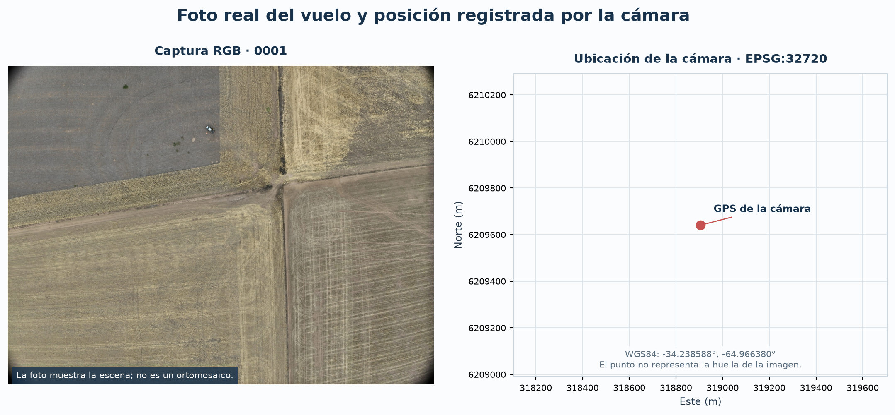
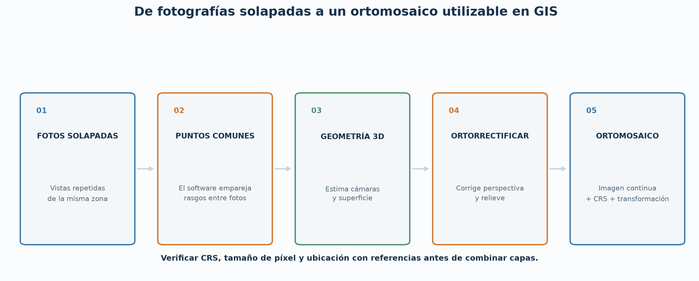
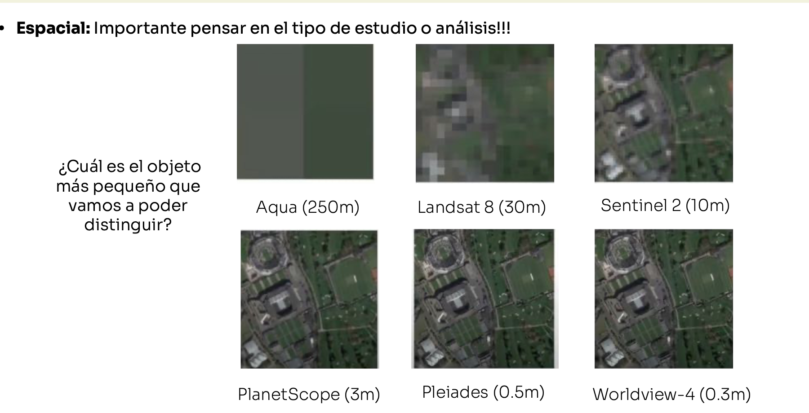
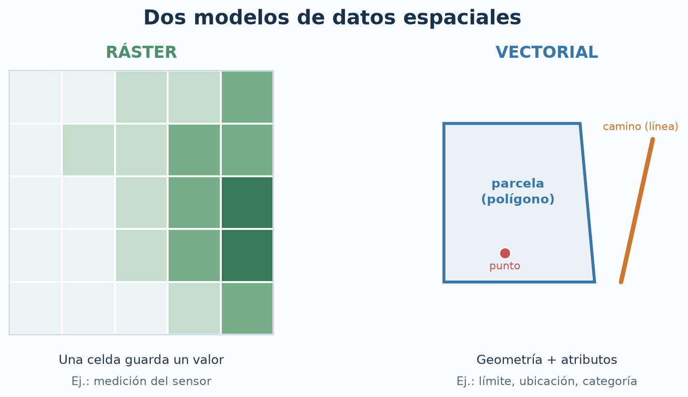
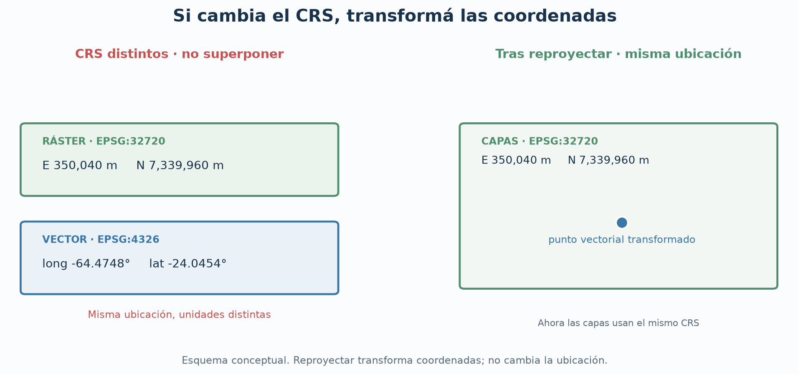
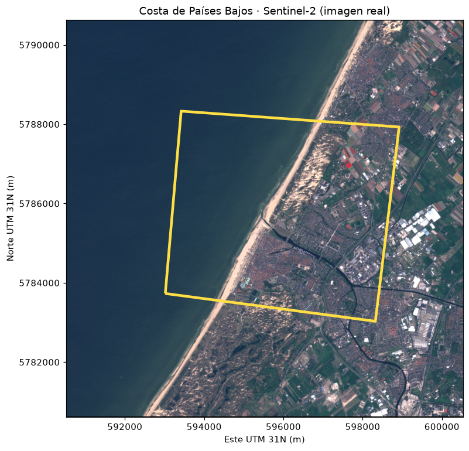

# Clase 2 — Elegir la imagen adecuada y ubicarla en el mapa

En la clase anterior aprendimos a observar una foto del lote: qué se ve, qué detalle permite distinguir y qué afirmaciones todavía requieren verificación. Ahora aparece una decisión habitual en un proyecto agro: **¿qué imagen conviene usar para la pregunta que queremos responder?**

Una foto de dron, un ortomosaico y una escena satelital pueden mostrar el mismo terreno, pero entregan información distinta. La elección depende del tamaño de lo que buscamos, la superficie a cubrir, la fecha que importa y si necesitamos volver a un lugar exacto en campo. En la [práctica visual](clase_02_demo_gis.ipynb) vamos a tomar esas decisiones con archivos reales y un ejemplo cartográfico preparado.

## Primero, la decisión de trabajo

Imaginemos tres pedidos sobre un lote:

1. **«Quiero mirar con detalle las hileras y el suelo en una captura».** Una foto RGB de dron permite inspección visual. Su GPS de cámara no ubica cada píxel en el terreno.
2. **«Quiero marcar un sector para que alguien lo visite».** Hace falta una imagen georreferenciada, como un ortomosaico, y el límite de la parcela. Así la observación puede convertirse en una ubicación revisable en campo.
3. **«Quiero seguir cambios de cobertura durante la temporada».** Conviene una serie de imágenes satelitales de fechas comparables. Cubren áreas extensas y ofrecen observaciones repetidas; el tamaño de píxel puede impedir distinguir plantas individuales.

En teledetección se comparan productos por **detalle espacial, cobertura, disponibilidad temporal y tipo de medición**. Sentinel‑2, por ejemplo, entrega bandas de 10, 20 y 60 m. Un trabajo de USGS muestra cómo imágenes de dron con píxeles de centímetros permiten observar hileras y plantas que no se distinguen con menor detalle. La fecha útil también depende de nubes y condiciones de captura. [Copernicus: Sentinel‑2](https://documentation.dataspace.copernicus.eu/Data/SentinelMissions/Sentinel2.html) · [USGS: flujo agrícola con dron y otros datos](https://pubs.usgs.gov/sir/2021/5013/sir20215013.pdf)

| Si la pregunta es… | Elegir primero… | Comprobar antes de usarla |
|---|---|---|
| ¿Qué aspecto tiene una zona pequeña hoy? | Foto RGB de dron | Fecha, nitidez, detalle y parte del lote cubierta. |
| ¿Dónde está una zona dentro de la parcela? | Ortomosaico georreferenciado + límite vectorial | Sistema de coordenadas, cobertura del lote y exactitud de ubicación. |
| ¿Cómo cambió la cobertura entre fechas o en varios lotes? | Serie satelital adecuada a la escala | Fechas, nubes, bandas y resolución espacial. |
| ¿Hay una diferencia de respuesta de la vegetación que RGB no muestra? | Producto multiespectral preparado | Bandas disponibles, alineación y significado de los valores. |

**La pregunta define la imagen; la imagen disponible limita la conclusión.** Una escena que muestra vegetación o un índice alto no identifica malezas por sí sola: hacen falta criterios agronómicos y observaciones verificadas en campo.

## Foto de dron y ortomosaico: dos productos distintos

La foto RGB del vuelo de Mendoza permite ver patrones finos y revisar visualmente una captura. Su GPS EXIF indica **dónde estaba la cámara**. No proporciona, por sí mismo, una posición de terreno para cada píxel.

Para construir un mapa continuo del lote se usan fotos solapadas. Un proceso fotogramétrico estima la geometría, corrige distorsiones y une las imágenes en un **ortomosaico**. OpenDroneMap, por ejemplo, puede entregar una ortofoto en GeoTIFF. La calidad de su posición debe revisarse de acuerdo con la decisión que se tomará; los puntos de control y las mediciones independientes ayudan cuando se necesita mayor exactitud. [OpenDroneMap: productos](https://docs.opendronemap.org/outputs/) · [OpenDroneMap: precisión cartográfica](https://docs.opendronemap.org/map-accuracy/)

En los archivos disponibles tenemos una foto RGB y bandas multiespectrales de una captura del vuelo, **no un ortomosaico de ese lote**. Para demostrar cómo se combinan capas usaremos además una **imagen satelital real y georreferenciada** de la costa de Países Bajos. Es otro lugar y otra escala: permite reconocer mar, playa y áreas urbanizadas, pero no plantas individuales.

## RGB, multiespectral y satelital: qué agrega cada imagen

**RGB** muestra luz visible en tres canales. Es útil para observar forma, hileras, sombras y color aparente. El color puede variar por iluminación, exposición y procesamiento de cámara; una zona verde no equivale a una especie identificada.

**Multiespectral** agrega mediciones en bandas que pueden incluir infrarrojo cercano. Se usa cuando la pregunta requiere comparar respuestas espectrales de suelo y vegetación, y más adelante permitirá entender índices como NDVI. Para comparar bandas hace falta comprobar que representen la misma zona, estén alineadas y que sus valores sean adecuados para el análisis. Tener archivos TIFF separados no garantiza esas condiciones.

**Satelital** describe áreas grandes y permite comparar fechas. Una escena de Sentinel‑2 puede servir para seguir patrones de cobertura de un lote, pero sus píxeles de 10 m o más mezclan lo que haya dentro de esa superficie. Por eso la búsqueda de plantas individuales suele pedir una captura de mayor detalle. No toda imagen satelital tiene la misma resolución: se revisa el producto concreto antes de elegirlo. [Copernicus: Sentinel‑2](https://documentation.dataspace.copernicus.eu/Data/SentinelMissions/Sentinel2.html) · [USGS: resolución y agricultura](https://www.usgs.gov/publications/remote-sensing-simulated-unmanned-aircraft-imagery-precision-agriculture-applications)

### Explorá imágenes reales en visores gratuitos

Abrí dos fuentes y compará **qué detalle ves, cuánta superficie cubren y si podés elegir otra fecha o banda**. Anotá una pregunta que cada imagen podría ayudar a responder y una conclusión que todavía no permite.

| Fuente | Para observar durante la clase |
|---|---|
| [Copernicus Browser](https://browser.dataspace.copernicus.eu/) | Imágenes satelitales Sentinel‑2: compará color natural con falso color o NDVI de la misma escena. Necesita [cuenta gratuita](https://documentation.dataspace.copernicus.eu/Applications/Browser.html). |
| [NASA Worldview](https://worldview.earthdata.nasa.gov/) | Capas satelitales de gran cobertura: compará dos fechas y observá qué cambios se distinguen a esa escala. |
| [The National Map Viewer](https://apps.nationalmap.gov/viewer/) | [Ortoimágenes aéreas NAIP](https://www.usgs.gov/media/images/tnmcorps-naip-imagery-layer) de Estados Unidos: acercate a un área agrícola y compará el detalle con Sentinel‑2. |
| [OpenAerialMap](https://imagery.hotosm.org/) | Abrí esta [escena de dron de Mendoza](https://imagery.hotosm.org/browse?lat=-33.0513&lon=-68.8196&zoom=16.8&selected_id=5c68285a00b30100059fc421): compará el detalle de las hileras con Sentinel‑2 y leé fecha, resolución y licencia en su ficha. |

Si querés superponer una imagen con el contorno de una zona, [QGIS](https://qgis.org/download/) es una herramienta gratuita para abrir capas ráster y vectoriales; la usaremos solo como complemento visual.

La [ficha de la escena de Mendoza](https://api.imagery.hotosm.org/browser/external/api.imagery.hotosm.org/stac/collections/openaerialmap/items/5c68285a00b30100059fc421) indica **dron**, productor **AgroCam**, **15 de febrero de 2019**, aproximadamente **5 cm por píxel** y licencia **CC BY 4.0**. Es otra captura, distinta del vuelo cuyos archivos usamos al comienzo del notebook. Sus colores violetas y anaranjados no deben interpretarse como colores naturales ni como un índice de vegetación sin comprobar cómo se generó la visualización.

La [práctica visual](clase_02_demo_gis.ipynb) **incluye una copia local de esa escena**: muestra la imagen completa y un recorte de 10 m × 10 m con unas 200 × 200 celdas. Comparalo con el único píxel de 10 m × 10 m que ampliamos en Sentinel‑2. Las escenas son de lugares y fechas diferentes; este contraste explica el **detalle espacial**, no un cambio del terreno.

## Para ubicar algo, necesitamos datos GIS

Una imagen es un **ráster**: una cuadrícula de celdas con valores. El límite de una parcela se representa como **vectorial**: un polígono con coordenadas y atributos. También son vectoriales un punto de muestreo y una línea de camino. Al combinar la imagen y el polígono podemos preguntar qué parte de lo observado cae dentro del lote. [ArcGIS Pro: datos ráster](https://pro.arcgis.com/en/pro-app/3.5/help/data/imagery/introduction-to-raster-data.htm)

La ubicación de una capa se expresa mediante un **sistema de referencia de coordenadas** o **CRS**. Es el acuerdo que permite interpretar sus números. WGS84 expresa posiciones en grados de latitud y longitud; un CRS UTM de la zona adecuada expresa distancias en metros y facilita medir superficies locales. Para superponer capas correctamente hay que conocer el CRS de cada una y, si difieren, transformarlas a uno común. Que un programa las muestre juntas no reemplaza la comprobación de sus datos originales. [QGIS: sistemas de referencia](https://docs.qgis.org/3.44/en/docs/user_manual/working_with_projections/working_with_projections.html)

Un **GeoTIFF** puede guardar los píxeles y la relación entre cada celda y sus coordenadas del terreno. La extensión `.tif` sola no alcanza para saber si esa información existe: se inspeccionan sus metadatos o archivos auxiliares. Un **GeoJSON** guarda geometrías y atributos; en nuestro ejemplo contiene una zona de observación dibujada para la actividad. Rasterio ayuda a abrir y revisar el ráster; GeoPandas hace lo mismo con la capa vectorial. En esta clase basta con reconocer **qué nos muestra cada herramienta**, sin memorizar funciones.

La imagen `costa_paises_bajos_sentinel2_rgb.tif` es una copia RGB para pantalla de una [muestra GeoTIFF de Sentinel‑2A](https://github.com/mommermi/geotiff_sample), atribuida a **Copernicus Sentinel 2020**. Conserva su georreferenciación y sus píxeles de 10 m; se ajustaron los tonos para verla en pantalla, por lo que sus colores no son valores de reflectancia para análisis. El archivo de origen no indica una fecha de captura más precisa. El polígono de `zona_observacion_costa.geojson` fue **dibujado para la clase**: no representa una parcela ni un límite oficial. La imagen usa **EPSG:32631 (UTM 31 Norte)** y el GeoJSON usa **EPSG:4326 (WGS84)**; el notebook transforma el polígono al CRS de la imagen para superponerlos. [Condiciones de uso de los datos Sentinel](https://cds.climate.copernicus.eu/licences/ec-sentinel).

En el [zoom del notebook](clase_02_demo_gis.ipynb) se marca una celda de esta imagen. Su fila y columna indican dónde está en el archivo; las coordenadas Este y Norte indican el centro de esa celda en el mapa. Los tres números RGB representan su **color de pantalla**, mientras que los 10 m × 10 m indican la superficie del terreno que cubre. Ampliar la celda permite verla, pero no recuperar objetos más pequeños que quedaron mezclados dentro de ella.

**Atribución de la imagen adaptada:** *Contains modified Copernicus Sentinel data 2020.*

## La comprobación que se hace antes de decidir

Frente a cualquier imagen o capa del proyecto, preguntá en este orden:

1. **¿Qué decisión quiero tomar?** Inspeccionar una captura, comparar fechas o enviar a alguien a una ubicación.
2. **¿Qué detalle necesito?** El objeto de interés debe ser distinguible al tamaño de píxel disponible.
3. **¿Cuándo y dónde se capturó?** Fecha, cobertura, nubes o sombras pueden cambiar la interpretación.
4. **¿Puedo ubicar el resultado?** Revisá CRS, georreferenciación y exactitud adecuada al uso.
5. **¿Qué evidencia falta?** Una ubicación o una señal espectral no determina por sí sola que haya malezas.

La [práctica demostrativa](clase_02_demo_gis.ipynb) muestra una foto real del vuelo, la posición de su cámara, una imagen satelital real con una zona de observación y la escena de dron de AgroCam. Al final vas a elegir un producto para cuatro pedidos de trabajo y justificar el límite de cada elección.
