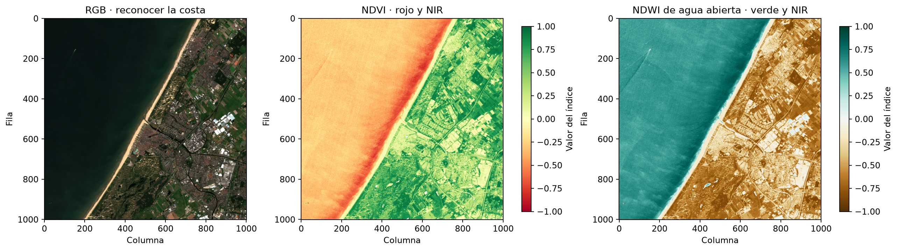

# Clase 3 — De las bandas a una pregunta: NDVI y NDWI

En la clase 2 vimos que **elegir una imagen depende de lo que queremos averiguar**. También ampliamos un píxel de Sentinel‑2: cada celda representaba 10 m × 10 m. Ahora vamos a usar varias mediciones de **esa misma celda** para responder dos preguntas diferentes: «¿dónde hay una señal compatible con cobertura vegetal?» y «¿dónde aparece agua abierta?».

La [práctica visual](clase_03_demo_indices.ipynb) usa una escena **real** de la costa de Países Bajos. Es la misma región de la clase anterior, pero una captura nueva del **12 de agosto de 2024**. Vas a practicar tres operaciones sobre la imagen: **reordenar bandas para cambiar la visualización, calcular un índice por píxel y seleccionar zonas candidatas con un umbral inicial**. Cada operación responde una pregunta distinta; Python permite ver el cambio sobre la escena.

Como continuación aplicada, la [guía demostrativa sobre cultivo y malezas](clase_03_caso_cultivo_y_malezas.ipynb) recorre un caso con imágenes multiespectrales reales de dron y etiquetas de referencia. Muestra cómo inspeccionar bandas, calcular NDVI/NDRE y contrastar los índices con las anotaciones, sin plantear ejercicios para resolver. La descarga inicial de datos es de unos 321 MB; preparala antes de la clase.

## Siglas y bandas que vamos a usar

| Sigla | Nombre completo | Qué significa en esta clase |
|---|---|---|
| **NDVI** | *Normalized Difference Vegetation Index* — Índice de Vegetación de Diferencia Normalizada | Compara rojo y NIR para destacar respuestas compatibles con vegetación. |
| **NDWI** | *Normalized Difference Water Index* — Índice de Agua de Diferencia Normalizada | El nombre se usa para fórmulas distintas. Acá es la variante verde–NIR para explorar agua abierta. |
| **NIR** | *Near Infrared* — infrarrojo cercano | Región del espectro que la vegetación suele reflejar más que el rojo. |
| **SWIR** | *Short-Wave Infrared* — infrarrojo de onda corta | Otra región infrarroja; algunas variantes de NDWI/NDMI la combinan con NIR. |
| **NDMI** | *Normalized Difference Moisture Index* — Índice de Diferencia Normalizada de Humedad | Nombre usado para índices NIR–SWIR relacionados con el contenido de agua de la vegetación. La nomenclatura varía entre fuentes. |
| **RGB** | *Red, Green, Blue* — rojo, verde, azul | Combinación de tres canales para mostrar una imagen en color. |

En Sentinel‑2, **B02** es azul, **B03** verde, **B04** rojo y **B08** NIR. Son identificadores de bandas, no nombres de índices. [USGS: siglas de sensores y bandas Landsat](https://www.usgs.gov/landsat-missions/landsat-acronyms); [USGS: distintos nombres del índice NIR–SWIR](https://www.usgs.gov/publications/terminology-spectral-vegetation-index-nir-swirnir-swir).

En la ficha de preparación también aparecen **DN** (*Digital Number*, valor digital original) y **SCL** (*Scene Classification Layer*, capa de clasificación de escena). Son datos que ayudan a preparar y revisar una imagen; no son índices. **USGS** es la sigla en inglés del Servicio Geológico de Estados Unidos, una de las fuentes de referencia enlazadas en este material.

## Primero, la pregunta y la escena

En la imagen se reconocen mar, playa, ciudad y zonas verdes. Antes de calcular nada, decidí qué querés distinguir:

| Pregunta | Medición que necesitamos mirar | Producto inicial |
|---|---|---|
| ¿Dónde hay una señal compatible con vegetación? | Cómo cambia la respuesta entre rojo e infrarrojo cercano. | **NDVI**. |
| ¿Dónde se destaca el agua abierta? | Cómo cambia la respuesta entre verde e infrarrojo cercano. | **NDWI de agua abierta**. |
| ¿Dónde hay una maleza o un cultivo con estrés hídrico? | Especie, contexto agronómico y/o otras mediciones, además de una imagen. | Estos dos índices **no alcanzan**. |

En un encargo real se define el entregable, se eligen fuente y bandas, se revisan calidad y resolución, y recién después se presenta una interpretación con sus límites. La misma fórmula puede ser útil o irrelevante según la pregunta. Si se busca un mapa para orientar una visita al terreno, una señal espectral puede ayudar a elegir zonas; para **decidir un manejo agronómico**, hace falta más evidencia.

La escena local [Sentinel‑2B Level‑2A](../../assets/geospatial/costa_paises_bajos_s2_20240812_reflectancia.tif) contiene cuatro bandas de **reflectancia de superficie**: azul B02, verde B03, rojo B04 e infrarrojo cercano B08. Cada una describe la proporción de luz registrada en una parte distinta del espectro. Las cuatro están alineadas sobre píxeles de **10 m**. La [ficha de preparación](../../assets/geospatial/costa_paises_bajos_s2_20240812_fuente.md) identifica la escena y explica qué se revisó antes de la práctica. [Bandas y resolución de Sentinel‑2](https://documentation.dataspace.copernicus.eu/Data/SentinelMissions/Sentinel2.html).

**Una celda, cuatro mediciones.** El RGB combina azul, verde y rojo para ayudarnos a reconocer el lugar. En pantalla se ajusta su brillo para distinguir mejor mar, playa y ciudad. Ese color mostrado **no es** el valor de reflectancia que usamos en las fórmulas. La banda NIR tampoco se ve como un color natural: es una medición adicional del mismo lugar. Por eso la posición de los píxeles debe coincidir entre bandas.

**No todas las imágenes permiten esto.** El RGB ajustado de la costa que usamos en la clase 2 sirve para ver formas, pero no contiene NIR ni valores de reflectancia adecuados para estos índices. Tampoco podemos atribuir una banda NIR a los tonos violetas de la escena de AgroCam solo por su aspecto. Cuando falta una banda identificada, hay que elegir otro producto o preparar los datos antes de calcular.

El vuelo multiespectral de Mendoza que conocimos en la clase 1 sí tiene bandas roja y NIR separadas. Para calcular un NDVI **por píxel** de ese vuelo todavía habría que comprobar que correspondan a la misma captura, estén alineadas sobre la misma grilla y representen valores comparables, además de revisar sombras y condiciones de adquisición. Por eso practicamos primero con una escena Sentinel ya preparada y documentada.

Un píxel de **10 m × 10 m** representa 100 m². En una orilla puede incluir agua y arena; en un lote, plantas y suelo descubierto. Su reflectancia resume lo que llegó al sensor desde esa superficie. Un índice tampoco indica por sí solo cuántas plantas hay dentro de la celda ni el porcentaje exacto de cobertura.

## ¿Por qué combinar bandas?

Dos superficies pueden parecer parecidas en RGB y devolver cantidades distintas de luz fuera de lo visible. La vegetación suele absorber más luz roja para la fotosíntesis y reflejar más infrarrojo cercano. El agua abierta suele reflejar poco infrarrojo cercano. Por eso una **comparación entre bandas** puede resaltar patrones que el color de pantalla no muestra con claridad.

Un índice normalizado compara la diferencia entre dos bandas con la suma de ambas. El resultado suele quedar entre **−1 y 1** cuando se usan reflectancias no negativas. La fórmula es corta; lo decisivo es saber **qué bandas entran, qué pregunta responde el resultado y qué lo puede confundir**.

La **resta** indica cuál banda tiene mayor valor. La **suma** pone esa diferencia en relación con el tamaño de ambas mediciones: una diferencia de 0,03 es grande si las bandas rondan 0,02, pero pequeña si rondan 0,30. Cuando las bandas son parecidas, el índice queda cerca de **0**. El signo positivo o negativo depende del **orden** en la fórmula; no representa una categoría universal. Si las dos bandas fueran cero, el índice quedaría indefinido y habría que tratar ese píxel como dato faltante.

| Índice | Bandas de esta escena | Lectura inicial |
|---|---|---|
| **NDVI = (NIR − rojo) / (NIR + rojo)** | B08 y B04 | Valores más altos indican que NIR supera al rojo. En esta escena resaltan zonas con cobertura vegetal. |
| **NDWI para agua abierta = (verde − NIR) / (verde + NIR)** | B03 y B08 | Valores más altos indican que verde supera al NIR. En esta escena resalta el mar. |

Por ejemplo, en un píxel visible como zona verde de nuestra escena, rojo ≈ **0,013** y NIR ≈ **0,390**: NDVI ≈ **0,93**. En un píxel del mar, verde ≈ **0,025** y NIR ≈ **0,006**: NDWI ≈ **0,63**. Esos números describen **estos píxeles de esta fecha**; no son umbrales universales ni etiquetas confirmadas en campo. [Ejemplos oficiales de índices con Sentinel‑2](https://documentation.dataspace.copernicus.eu/notebook-samples/sentinelhub/getting_started/custom_scripts/1_basic_evalscripts.html).

### Leer NDVI sin convertirlo en un diagnóstico

La vegetación que realiza fotosíntesis suele absorber rojo y reflejar NIR. En el píxel **C**, NIR ≈ 0,3904 y rojo ≈ 0,0133: `(0,3904 − 0,0133) / (0,3904 + 0,0133) ≈ 0,93`. En **B**, NIR ≈ 0,3496 y rojo ≈ 0,3152: el resultado es apenas **0,05**. En ambos NIR supera al rojo, pero el **contraste relativo** es muy diferente. El notebook permite ver esos dos lugares y sus mediciones.

NDVI es útil para **explorar diferencias de respuesta vegetal** dentro de una escena. Si se comparan fechas, hay que revisar que las escenas y sus condiciones sean comparables: estación, etapa del cultivo, nubes, sombras y procesamiento. En vegetación dispersa puede influir el suelo que se ve entre plantas; en vegetación muy densa el índice puede perder sensibilidad a nuevos aumentos de cobertura. Un NDVI alto **no demuestra** que el cultivo esté sano, y uno bajo **no explica por sí solo** la causa. [USGS: uso y límites del NDVI](https://www.usgs.gov/special-topics/remote-sensing-phenology/science/ndvi-foundation-remote-sensing-phenology).

### Leer NDWI de agua abierta

En el píxel **A** del mar, verde ≈ 0,0249 y NIR ≈ 0,0056: `(0,0249 − 0,0056) / (0,0249 + 0,0056) ≈ 0,63`. El mapa destaca el mar porque allí el NIR es bajo frente al verde. Esto permite **explorar** agua abierta; no entrega automáticamente un límite de costa exacto. En la orilla hay píxeles mezclados, y un valor aislado requiere comparación con RGB, fecha, resolución y contexto.

**Leé la figura de izquierda a derecha.** El RGB ayuda a reconocer la costa; el NDVI destaca patrones de vegetación; el NDWI destaca agua abierta. Las barras de color representan valores del índice, no clases «maleza», «cultivo sano» o «riego necesario».

Para leer un resultado, separá **dato, interpretación y afirmación pendiente**. Por ejemplo: «En C, NDVI ≈ 0,93» es un dato de esta captura; «el contraste es compatible con vegetación en una zona que se ve verde» es una interpretación apoyada por RGB; «hay un cultivo sano» requeriría información que esta escena no proporciona. Con el agua sucede algo semejante: un píxel representativo del mar ayuda a entender el índice, pero un mapa de límites necesita revisión adicional.

## «NDWI» necesita apellido

En esta clase usamos **NDWI de agua abierta**, definido con verde y NIR. En otros trabajos, «NDWI» nombra una combinación **NIR y SWIR** relacionada con el contenido de agua de la vegetación; también se la llama **NDMI**. Por eso, antes de usar un producto llamado NDWI, pedí la **fórmula y las bandas**, además del nombre. Nuestra escena preparada no incluye SWIR: no sirve para calcular la segunda variante. [USGS: nombres de índices NIR–SWIR](https://www.usgs.gov/publications/terminology-spectral-vegetation-index-nir-swirnir-swir).

**Ejemplo de pedido ambiguo:** «Prepará un NDWI para el lote». Si se quiere señalar agua abierta, usaríamos verde y NIR; si se busca una señal relacionada con agua en la vegetación, habría que discutir la variante NIR–SWIR y obtener otra banda. Antes de escribir una fórmula, preguntá **qué fenómeno se quiere observar y con qué producto se tomará una decisión**.

## Antes de interpretar un mapa de índices

1. **Comprobá el producto:** fecha, fuente y si los valores son reflectancia o colores preparados para pantalla.
2. **Comprobá las bandas:** cada fórmula necesita mediciones identificadas del mismo lugar y de la misma captura, alineadas píxel a píxel.
3. **Revisá calidad y escala:** nubes, sombras, superficies mezcladas y resolución pueden cambiar lo que parece mostrar el mapa. En esta práctica se excluyeron las clases problemáticas de la clasificación de escena antes de calcular.
4. **Separá señal de decisión:** un valor alto o bajo orienta dónde observar; la especie, el estrés hídrico y el manejo requieren más evidencia.

| Si alguien pide… | Entrega inicial razonable | Evidencia que falta antes de actuar |
|---|---|---|
| Explorar cobertura en un área amplia. | Mapa NDVI de una escena adecuada y zonas para revisar. | Contexto del terreno y calidad; si hay comparación temporal, escenas comparables. |
| Revisar la franja de agua abierta. | NDWI verde–NIR contrastado con RGB. | Control de orillas y píxeles mezclados; referencia de campo si el límite será operativo. |
| Decidir riego o identificar malezas. | Plantear una búsqueda de datos más específica. | Suelo, cultivo, clima, observaciones del lote, resolución y validación de especies según el pedido. |

En la [práctica](clase_03_demo_indices.ipynb) vas a describir patrones visibles, contrastarlos con tres píxeles concretos y elegir qué índice, o qué dato adicional, respondería distintos pedidos. **No compares numéricamente** esta escena de 2024 con el RGB de 2020 de la clase 2: son productos y fechas distintos.

**Fuente de la escena:** [Sentinel‑2B Level‑2A, 12/08/2024](https://earth-search.aws.element84.com/v1/collections/sentinel-2-c1-l2a/items/S2B_T31UET_20240812T105014_L2A). *Contains modified Copernicus Sentinel data 2024.*
