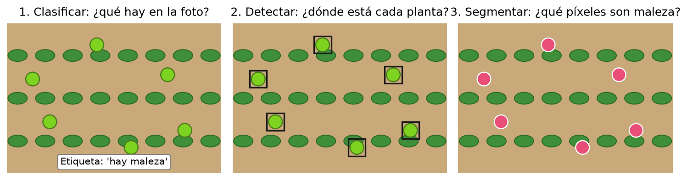
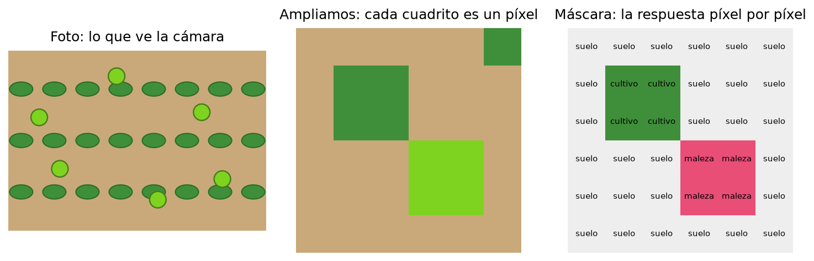
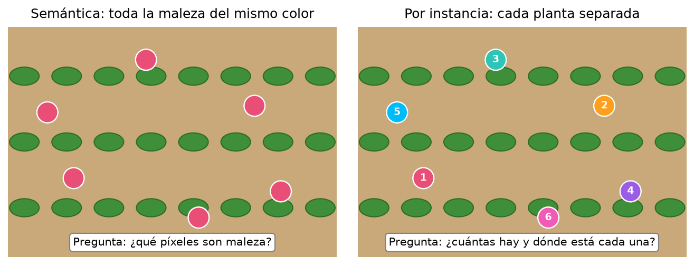
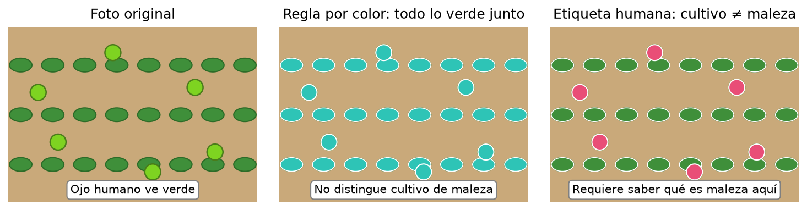
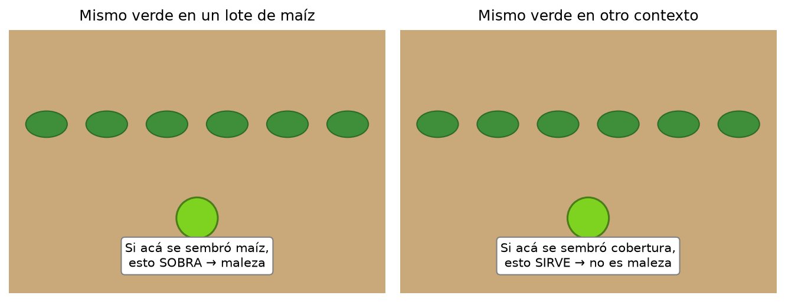
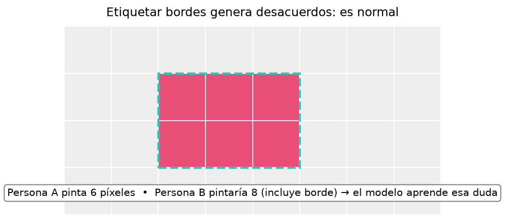
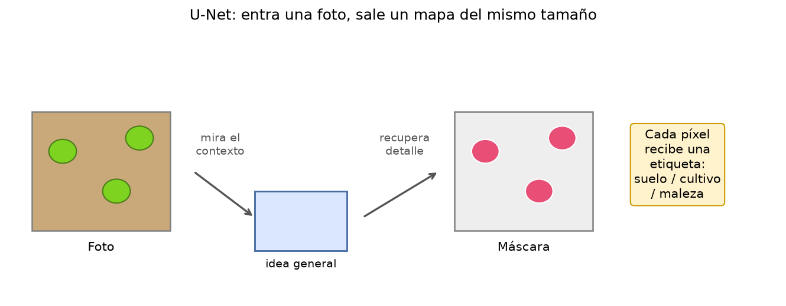
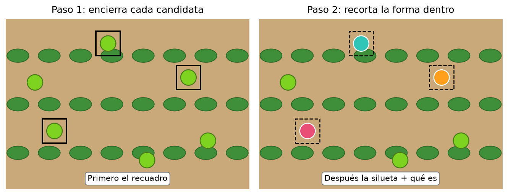

# Clase 4 — Pintar el lote píxel por píxel: qué es segmentar

En la clase 3 aprendimos a combinar bandas para obtener una **señal** de vegetación o de agua. Esa señal decía «acá hay algo parecido a vegetación», pero no decía **qué planta es** ni **dónde termina una y empieza otra**.

Hoy damos el paso siguiente: **pintar el lote**. Cada píxel recibe una etiqueta: suelo, cultivo o maleza. Ese mapa pintado se llama **máscara**. Y a la tarea de producirlo se la llama **segmentación**.

En el procesamiento de datos geoespaciales y vegetación, U-Net es el estándar para la segmentación semántica, mientras que Mask R-CNN es el referente clásico para la segmentación de instancias.

A continuación, se detalla cómo funciona cada arquitectura y cómo se aplican específicamente al análisis de coberturas vegetales y agrícolas.

### U-Net (Segmentación Semántica)

Diseñada originalmente para imágenes biomédicas, su estructura en forma de "U" la hace extraordinariamente eficiente para clasificar terrenos píxel a píxel a partir de imágenes satelitales o de drones.
Estructura Conceptual de U-Net:

```text
Camino de Contracción (Encoder)             Camino de Expansión (Decoder)
[Imagen] -> Conv -> MaxPool \               / ConvTransposed -> [Máscara]
                             \ Conexiones  /
                              \ Directas  /
                               \  (Skip) /
                                \       /
                                 [Latent]
```

Aplicación en Vegetación:

- Mapeo continuo de cobertura del suelo (identificar qué píxeles son bosque denso, pastizal, suelo desnudo o agua).
- Procesamiento de imágenes multiespectrales (Sentinel-2 o Landsat) para segmentar zonas afectadas por deforestación o incendios.
- Delimitación de parcelas agrícolas completas sin importar cuántas plantas individuales contenga cada una.


### Mask R-CNN (Segmentación de Instancias)

Es una extensión de Faster R-CNN desarrollada por el equipo de investigadores de Meta (FAIR). No solo encuentra objetos en la imagen, sino que genera una máscara perfecta para cada uno de ellos de forma independiente.

Estructura Conceptual de Mask R-CNN:

```
               /--> Rama de Clasificación (¿Qué es?) y Bounding Box (¿Dónde está?)
[Imagen] -> Backbone -> RPN 
               \--> Rama de Máscara (Segmentación píxel a píxel de la instancia)
```

Aplicación en Vegetación:

- Conteo e inventariado de árboles: Aislar y vectorizar cada copa de árbol individual en áreas urbanas o plantaciones comerciales.
- Conteo de frutos/cultivos de alto valor: Detectar y segmentar de manera individual piñas, manzanas o plantas de vid para estimar rendimientos por hectárea.
- Detección de árboles muertos o enfermos: Aislar un espécimen específico que muestra estrés hídrico o plagas para guiar un tratamiento focalizado con drones.

Comparativa de Rendimiento en Proyectos SIG / GeoAI


## Comparación rápida: U-Net vs Mask R-CNN

| Criterio | U-Net | Mask R-CNN |
|---|---|---|
| Complejidad del Dataset | Más simple de etiquetar (solo pintas las zonas de vegetación). | Más laborioso (cada árbol debe tener su propia etiqueta/ID independiente). |
| Cómputo Requerido | Moderado. Ideal para grandes extensiones satelitales. | Alto. Requiere GPUs potentes debido a la detección por regiones. |
| Manejo de Solapamientos | Malo. Si las copas de dos árboles se tocan, las unirá en un solo polígono. | Bueno. Puede entender que son dos árboles distintos aunque sus copas se crucen. |
| Formato de Salida Común | Raster (GeoTIFF con códigos de clase). | Vectorial (GeoJSON o Shapefile con geometrías individuales). |


La [práctica visual](clase_04_demo_segmentacion.ipynb) trabaja siempre sobre una imagen real de maíz con malezas (WeedsGalore). Vas a comparar tres formas de pintar: **una regla por color, una agrupación automática (K-Means) y una etiqueta hecha por personas**. Cada una responde una pregunta distinta; solo la última sabe qué es maleza en ese lote.

## Primero, ¿qué pregunta queremos responder?

Imaginá que alguien te muestra una foto del lote y te pide ayuda. Según lo que necesite, la respuesta tiene distinta forma:

| Pregunta | Respuesta que entrega | Ejemplo en el lote |
|---|---|---|
| ¿Hay maleza en esta foto? | Una etiqueta para toda la imagen. | «Sí, hay maleza». |
| ¿Dónde está cada planta? | Un recuadro por planta. | Un cuadrado alrededor de cada yuyo. |
| ¿Qué píxeles son maleza? | Una etiqueta por píxel. | El mapa pintado píxel por píxel. |

La primera tarea se llama **clasificación**: mira la foto completa y decide una categoría. La segunda es **detección**: encierra objetos con recuadros. La tercera es **segmentación**: pinta cada píxel. En esta clase nos concentramos en la tercera, porque es la que permite medir **cuánta superficie** ocupa cada cosa y **con qué forma**.



**Leé la figura de izquierda a derecha.** Clasificar responde sobre la foto entera; detectar marca cada planta con un recuadro; segmentar pinta los píxeles que pertenecen a cada categoría. Más detalle no siempre es mejor: depende de la decisión que hay que tomar. Para contar plantas alcanza con recuadros; para medir superficie cubierta hace falta pintar píxeles.

## ¿Qué es una máscara?

Una máscara es **una imagen de respuestas** del mismo tamaño que la foto. Donde la foto guarda colores, la máscara guarda etiquetas: 0 = suelo, 1 = cultivo, 2 = maleza. Cada cuadrito de la grilla recibe una sola etiqueta.



**Leé la figura de izquierda a derecha.** La foto muestra el lote; al ampliar, cada cuadrito es un píxel; la máscara escribe en cada cuadrito qué hay: suelo, cultivo o maleza. La máscara no es una foto más linda: es **la respuesta** que queremos que el modelo aprenda a producir.

Fijate que la máscara necesita **saber** qué es cada cosa. El color verde por sí solo no alcanza: el cultivo y la maleza pueden verse parecidos. Alguien tiene que decir «esto es cultivo, esto es maleza» para que la máquina tenga de dónde aprender.

## Semántica o por instancia: dos formas de pintar

Hay dos preguntas parecidas que se responden con dos mapas distintos:

- **Segmentación semántica:** pinta **todos los píxeles de maleza del mismo color**. Responde «¿qué píxeles son maleza?». No distingue una planta de otra.
- **Segmentación por instancia:** pinta **cada planta con un color o número distinto**. Responde «¿cuántas plantas hay y dónde está cada una?».



En el panel izquierdo, las seis malezas comparten el rosa: sabemos **cuánta superficie** ocupan, pero no cuántas hay sin contarlas a ojo. En el panel derecho, cada una tiene su número: podemos **contarlas** (seis) y ubicar cada una por separado.

| Si necesitás… | Te sirve… | Ejemplo en el lote |
|---|---|---|
| Medir superficie con maleza. | Semántica. | «El 8 % del sector está cubierto». |
| Contar plantas individuales. | Por instancia. | «Hay 6 plantas en este sector». |
| Planificar una pasada selectiva planta por planta. | Por instancia. | Ir a cada punto marcado. |

Las dos parten de la misma idea (etiquetar píxeles); cambia **qué pregunta** responde el mapa.

## Por qué el color solo no alcanza

En la clase 3 vimos que el NDVI destaca vegetación. Pero «vegetación» no es lo mismo que «maleza». El cultivo también es vegetación. Una regla como «todo lo verde es maleza» pinta las dos cosas juntas.



**Leé la figura de izquierda a derecha.** La foto muestra cultivo en hileras y malezas dispersas. La regla por color pinta **todo lo verde** del mismo color: no distingue. La etiqueta humana separa cultivo (verde oscuro) de maleza (rosa): para eso necesitó **saber** qué se sembró y qué sobra.

Un agrupamiento por color hace exactamente eso: busca, por ejemplo, 3 tonos promedio y asigna cada píxel al más parecido, **sin saber** qué significan. Es útil para ver la diferencia con una máscara etiquetada, no para identificar malezas.

## Quién decide qué es maleza

«Maleza» no es una especie fija: es **una planta que sobra en ese lote**. La misma planta puede ser maleza en un campo y cultivo en otro.



Por eso las etiquetas las define **alguien que conoce el lote**: qué se sembró, en qué fecha, qué se considera maleza acá. Sin esa definición agronómica, ningún modelo puede aprender a identificar malezas: solo puede agrupar colores o copiar ejemplos sin entenderlos.

Y etiquetar tiene sus dudas normales. En el borde de una hoja, dos personas pueden pintar distinto: una incluye el píxel del borde, la otra no.



Eso no es un error: es parte del trabajo. El modelo aprende de esos ejemplos con sus desacuerdos incluidos. Por eso una máscara nunca es perfecta, y por eso en la clase 5 veremos cómo **medir** qué tan bien pinta.

## Dos modelos famosos, en lenguaje simple

Con las etiquetas listas, un modelo aprende a producir máscaras para fotos nuevas. Hay dos arquitecturas muy usadas. No hace falta entender sus piezas internas: alcanza con saber **qué entra, qué sale y cuándo conviene cada una**.

### U-Net: entra una foto, sale un mapa del mismo tamaño

U-Net recibe la foto y devuelve una máscara **del mismo tamaño**: a cada píxel le asigna una etiqueta. Su truco es mirar primero la escena en chiquito (la «idea general»: dónde hay hileras, dónde hay suelo) y después recuperar el detalle (el borde exacto de cada hoja).



Pensalo como copiar un dibujo mirando primero de lejos (para ubicarte) y después de cerca (para los bordes). U-Net es el ejemplo típico de **segmentación semántica**: pinta categorías, no separa plantas individuales.

### Mask R-CNN: primero encierra, después recorta

Mask R-CNN trabaja en dos pasos. Primero **detecta**: encierra cada planta candidata en un recuadro. Después **recorta**: dentro de cada recuadro, pinta la silueta exacta y dice qué es.



Pensalo como buscar monedas en una mesa: primero señalás cada una con el dedo (recuadro), después dibujás su contorno (máscara). Es el ejemplo típico de **segmentación por instancia**: separa y cuenta objetos.

| Modelo | Qué entrega | Pregunta que responde | Cuándo pensarlo |
|---|---|---|---|
| U-Net | Una etiqueta por píxel. | ¿Qué superficie ocupa cada categoría? | Mapa de cobertura para recorrer. |
| Mask R-CNN | Un recuadro + silueta por planta. | ¿Cuántas hay y dónde está cada una? | Conteo o acción planta por planta. |

Los dos necesitan **fotos con máscaras hechas por personas** para entrenar. Sin etiquetas, no hay aprendizaje: solo reglas por color o agrupamientos sin significado agronómico.

## Lo que te llevás de hoy

1. **Segmentar es pintar cada píxel** con una etiqueta: suelo, cultivo o maleza.
2. **Semántica** mide superficie; **por instancia** cuenta plantas separadas.
3. **El color no identifica malezas**: una regla por color o un agrupamiento mezcla cultivo y maleza.
4. **«Maleza» la define el lote**: la etiqueta requiere saber qué se sembró y qué sobra.
5. **U-Net** pinta mapas por categoría; **Mask R-CNN** separa cada planta en dos pasos.

En la [práctica](clase_04_demo_segmentacion.ipynb) vas a pintar una mini-máscara a mano sobre un recorte real, comparar la regla por color con la etiqueta de campo y ver dónde aparecen los desacuerdos. **No vas a entrenar ningún modelo**: vas a entender qué información necesita uno para aprender.

**Conexión con el lote de Mendoza:** para segmentar malezas en ese vuelo harían falta recortes alineados de sus bandas, una definición de qué cuenta como maleza en ese lote y máscaras de referencia verificadas. La foto RGB sola, por más nítida que sea, no alcanza.
