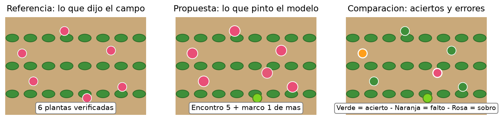
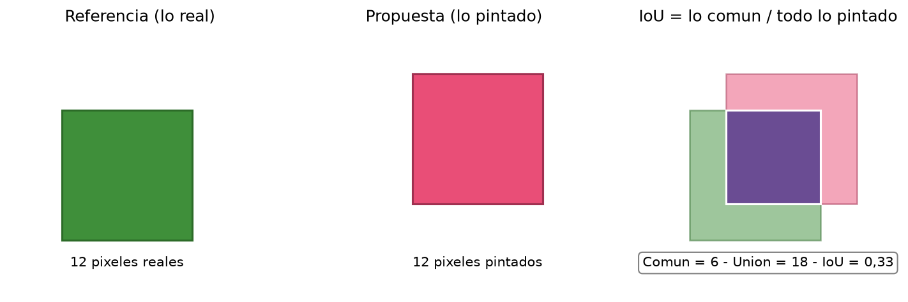
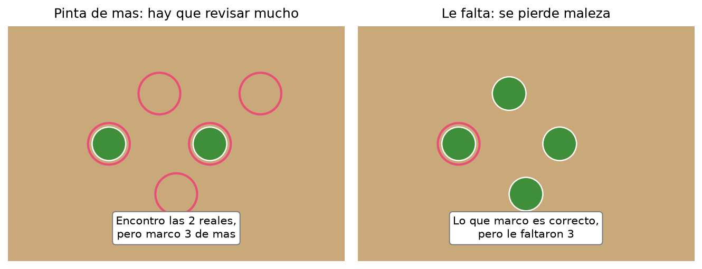
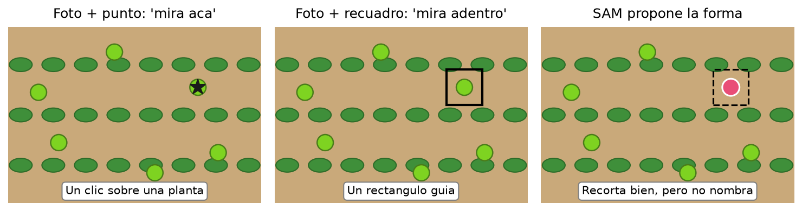
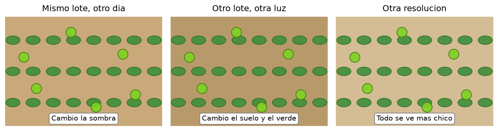

# Clase 5 — ¿Qué tan bien pinta? Medir máscaras y conocer a SAM

En la clase 4 aprendimos a **pintar** cada píxel: suelo, cultivo o maleza. También vimos que pintar a mano tiene dudas normales en los bordes. Entonces aparece una pregunta inevitable: si dos personas pintan distinto, y un modelo pinta una tercera versión, **¿cómo decidimos si pinta bien?**

Hoy respondemos eso. Vamos a comparar lo que pinta un modelo (la **propuesta**) con lo que dijo el campo (la **referencia**), contar aciertos y errores, y resumirlos en números que se usan en la industria: **IoU, precisión, recall y F1**. También vamos a conocer a **SAM**, un modelo que propone formas sin saber sus nombres, y a entender por qué un buen resultado en un lote no garantiza lo mismo en otro.

La [práctica visual](clase_05_demo_metricas.ipynb) trabaja siempre sobre la misma imagen real de maíz con malezas de la clase 4 (WeedsGalore, 600 × 600 píxeles). Vas a comparar una regla por color con la etiqueta de campo, calcular sus métricas con NumPy y simular cómo SAM respondería a un punto o a un recuadro. **No vas a entrenar ningún modelo**: vas a aprender a medir y a pedir el número correcto según la decisión en campo.

## Términos que vamos a usar

| Término | Qué significa en esta clase |
|---|---|
| **Propuesta** | Lo que pintó el modelo o la regla que queremos evaluar. |
| **Referencia** | Lo que dijeron las personas que conocían el lote; la respuesta correcta para este ejercicio. |
| **Acierto** (*verdadero positivo*) | Los dos dicen «maleza». |
| **Sobrante** (*falso positivo*) | Solo la propuesta dice «maleza»: alarma de más. |
| **Faltante** (*falso negativo*) | Solo la referencia dice «maleza»: maleza no encontrada. |
| **IoU** (*Intersection over Union*, intersección sobre unión) | Lo común dividido todo lo pintado por alguien; mide superposición. 1 es perfecto, 0 es nada. |
| **mIoU** | Promedio del IoU sobre varias clases. |
| **Precisión** | De lo pintado, cuánto era verdad; castiga pintar de más. |
| **Recall** (*exhaustividad*) | De lo real, cuánto encontró; castiga que falte. |
| **F1** | Combina precisión y recall en un número; mejor por clase. |
| **mAP** (*mean Average Precision*, precisión media promedio) | Resumen para detección con recuadros; acá solo se ubica, no se calcula. |
| **SAM** (*Segment Anything Model*, modelo segmentador de Meta) | Propone formas desde una indicación, sin poner nombres. |
| **Indicación** (*prompt*: punto o recuadro) | Lo que le mostramos a SAM para decirle «mirá acá». |
| **Generalización** | Qué tan bien se mantiene el resultado en otro lote, fecha, luz o resolución. |

## Propuesta y referencia: dos mapas para comparar

Para medir necesitamos dos mapas del mismo tamaño:

- **Referencia:** lo que dijeron las personas que conocían el lote. Es nuestra respuesta correcta para este ejercicio.
- **Propuesta:** lo que pintó el modelo o la regla que queremos evaluar.

**Leé la figura de izquierda a derecha.** La referencia marca 6 plantas verificadas. La propuesta encontró 5 y marcó 1 de más en otro lugar. Al superponerlas aparecen tres situaciones: verde donde coinciden, naranja donde a la propuesta **le faltó**, rosa donde a la propuesta **le sobró**.

En el lote esto tiene costo distinto. Lo que **falta** es maleza que nadie irá a revisar. Lo que **sobra** es tiempo de recorrida en un lugar donde no había nada. Por eso no alcanza con decir «pinta bien»: hay que contar **cuánto falta y cuánto sobra**.

Cada píxel cae en una de estas situaciones:

| Situación | Qué significa | Ejemplo en el lote |
|---|---|---|
| Acierto (verdadero positivo) | Los dos dicen «maleza». | Fuimos y había maleza. |
| Sobrante (falso positivo) | La propuesta dice «maleza», la referencia dice «no». | Fuimos y no había nada. |
| Faltante (falso negativo) | La referencia dice «maleza», la propuesta dice «no». | No fuimos y había maleza. |

Fijate que «positivo» acá significa «marcado como maleza», no «bueno». Un falso positivo no es un acierto: es una alarma de más.

## IoU: cuánto se superponen

La pregunta más directa es: de todo lo que alguien pintó (referencia o propuesta), ¿en cuánto coinciden? Eso mide **IoU** (*Intersection over Union*, intersección sobre unión).

**Leé la figura de izquierda a derecha.** La referencia ocupa 12 píxeles, la propuesta otros 12 en otra posición. Coinciden en 6 (violeta). Todo lo pintado por alguien suma 18. IoU = 6 / 18 ≈ 0,33.

- Si pintan exactamente igual, IoU = 1.
- Si no se tocan en nada, IoU = 0.
- Los bordes difusos bajan el IoU aunque la planta se haya encontrado: por eso un IoU de 0,7 ya puede ser un buen contorno en una foto real.

IoU sirve para **una clase a la vez** (por ejemplo, solo maleza). Si queremos resumir varias clases, se promedia: eso es el **mIoU** (IoU medio). Y si queremos saber si el contorno está bien dibujado, IoU es la primera medida que pide la industria.

## Pintar de más o pintar de menos: dos errores distintos

IoU resume todo en un número, pero esconde **qué tipo de error** comete el modelo. En el campo esa diferencia importa:

- **Precisión:** de todo lo que el modelo marcó, ¿cuánto era verdad? Si marca mucho de más, la precisión baja. En el campo significa **recorridas de más**.
- **Recall (exhaustividad):** de toda la maleza real, ¿cuánta encontró? Si le falta mucho, el recall baja. En el campo significa **maleza sin detectar**.

| Si te preocupa… | Pedí… | Ejemplo |
|---|---|---|
| No hacer ir a la gente de gusto. | Precisión alta. | «Que casi todo lo marcado sea maleza real». |
| No dejar maleza sin ver. | Recall alto. | «Que encuentre casi toda la maleza que hay». |

Los dos no mejoran juntos gratis: si el modelo pinta más, suele encontrar más (sube recall) pero se equivoca más (baja precisión). Elegir el punto justo depende de la decisión: para una recorrida cara se prefiere precisión; para una plaga que no puede escaparse se prefiere recall.

**F1** combina las dos en un solo número: es el promedio armónico de precisión y recall. Sirve cuando querés una sola cifra para comparar modelos, pero siempre conviene mirar las dos por separado para saber **por qué** falla. En la práctica se calcula **F1 por clase** (uno para maíz, otro para malezas), porque un modelo puede pintar bien el cultivo y mal la maleza.

¿Y **mAP**? Es la métrica que resume detección con recuadros (¿dónde está cada planta y con qué confianza?). Promedia la precisión a distintos niveles de exigencia y sobre todas las clases. Acá la ubicamos nomás: si el pedido es **contar plantas con recuadros** (Mask R-CNN), la industria pide mAP; si el pedido es **pintar superficie** (U-Net), alcanza con IoU y F1 por clase.

## SAM: propone formas, no pone nombres

Hasta ahora evaluamos reglas que pintan solas. **SAM** (*Segment Anything Model*, de Meta) trabaja distinto: no decide qué es maleza. Recibe una **indicación** (un punto, un recuadro) y devuelve la forma que mejor encierra eso.

**Leé la figura de izquierda a derecha.** Con un clic sobre una planta, SAM recorta su silueta. Con un recuadro guía, hace lo mismo. En los dos casos entrega **el contorno**, no la etiqueta «maleza»: decir si sobra o sirve lo hace después una persona que conoce el lote.

Por eso SAM se usa como **asistente de etiquetado**: acelera el pintado de bordes, pero cada propuesta necesita revisión humana. Recorta bien, incluso en objetos que nunca vio, pero no sabe qué se sembró en ese campo. Sin esa validación agronómica, sus máscaras son formas sin significado, igual que la regla por color de la clase 4.

En la práctica vas a simular sus dos indicaciones sobre la imagen real: un punto dentro de una maleza y un recuadro alrededor. Vas a ver que la forma sale bien, pero el nombre «maleza» lo ponés vos al comparar con la referencia.

## Un buen número acá no garantiza allá

Un modelo puede dar IoU alto en la imagen donde se probó y fallar en la siguiente. Cambia el lote, cambia la foto:

- **Otro día:** cambia la sombra y el brillo. El verde se ve distinto.
- **Otro lote:** cambia el suelo y el tono de las plantas. Lo que era «verde de maleza» ahora se confunde.
- **Otra resolución:** todo se ve más chico. Los bordes que antes eran nítidos ahora mezclan planta y suelo en un píxel.

A esto se lo llama **generalización**: qué tan bien se mantiene el resultado fuera de las fotos conocidas. Por eso en un encargo real se pide probar en **otro lote, otra fecha y otra iluminación** antes de confiar. Un solo IoU en una sola imagen no alcanza para decir «funciona».

Tampoco hay que mezclar dos calidades: que el **contorno** esté bien dibujado (IoU alto) no prueba que la **etiqueta** sea correcta («esto es maleza»). La primera se mide con píxeles; la segunda se valida en campo con alguien que sepa qué se sembró.

## Lo que te llevás de hoy

1. **Medir es comparar** propuesta con referencia y contar aciertos, sobrantes y faltantes.
2. **IoU** mide superposición: lo común dividido todo lo pintado. 1 es perfecto, 0 es nada.
3. **Precisión** castiga pintar de más; **recall** castiga que falte. **F1** los resume, mejor por clase.
4. **mAP** resume detección con recuadros; para pintar superficie alcanzan IoU y F1.
5. **SAM propone formas** desde un punto o recuadro, pero no nombra: necesita revisión humana.
6. **Un número solo no garantiza**: hay que probar en otro lote, fecha, luz y resolución.

En la [práctica](clase_05_demo_metricas.ipynb) vas a calcular estas métricas sobre la imagen real con NumPy, separar F1 de maíz y de malezas, y simular las indicaciones de SAM. Vas a ver con números lo que en la clase 4 veías a ojo: la regla encuentra vegetación pero mezcla clases.

**Conexión con el lote de Mendoza:** para informar un IoU de ese vuelo harían falta máscaras de referencia verificadas de ese mismo lote y fecha. Sin ellas, cualquier número sería contra otra regla, no contra el campo. Y antes de llevar un modelo a otro lote, habría que repetir la medición allá.
