# Clase 6 — De la imagen al dato: un recorrido por el módulo 3

## Propósito de la clase

La primera parte recupera el hilo que une las clases 1 a 5: **partimos de una pregunta sobre el terreno, elegimos datos con una escala adecuada, los ubicamos, extraemos señales, producimos una propuesta y revisamos qué tan confiable es**.

La segunda parte amplía el recorrido hacia las imágenes satelitales: cómo buscar escenas para un lugar y una fecha, cómo inspeccionarlas y qué papel cumplen Copernicus Browser, Earth Search, Google Earth Engine y Sentinel Hub.

---

## Primera parte — Repaso conceptual de las clases 1 a 5

### 1. Una imagen es una medición, no el terreno mismo

Cuando miramos una fotografía aérea parece que vemos directamente el campo. En realidad, vemos una representación construida a partir de la energía que un sensor registró en unas condiciones concretas. La superficie refleja parte de la energía, el sensor la mide y el sistema la organiza como valores.

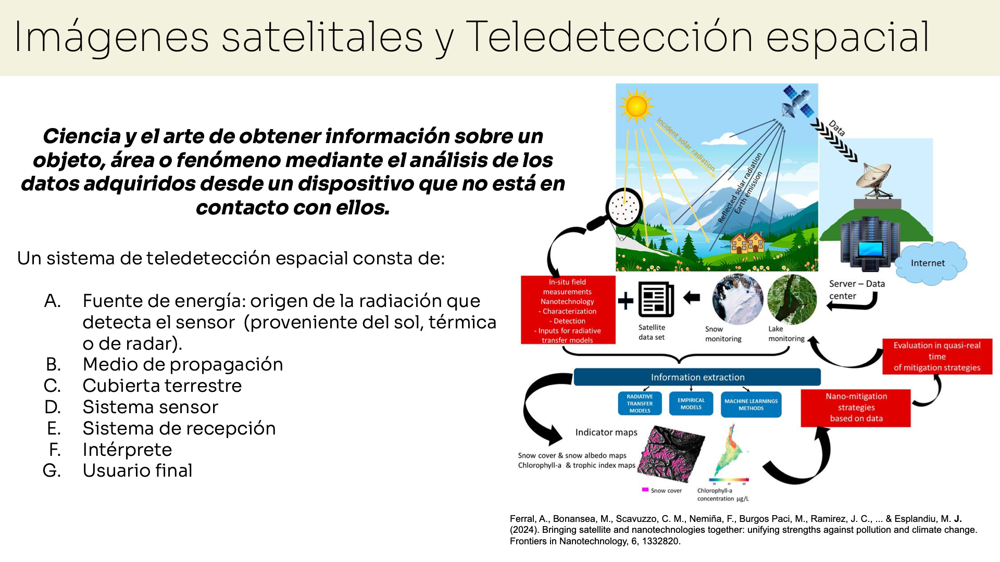

Esos valores se organizan en una cuadrícula. Cada celda es un **píxel**. En una imagen RGB, cada píxel tiene valores para rojo, verde y azul; otros sensores registran bandas fuera de la luz visible, como el infrarrojo cercano.

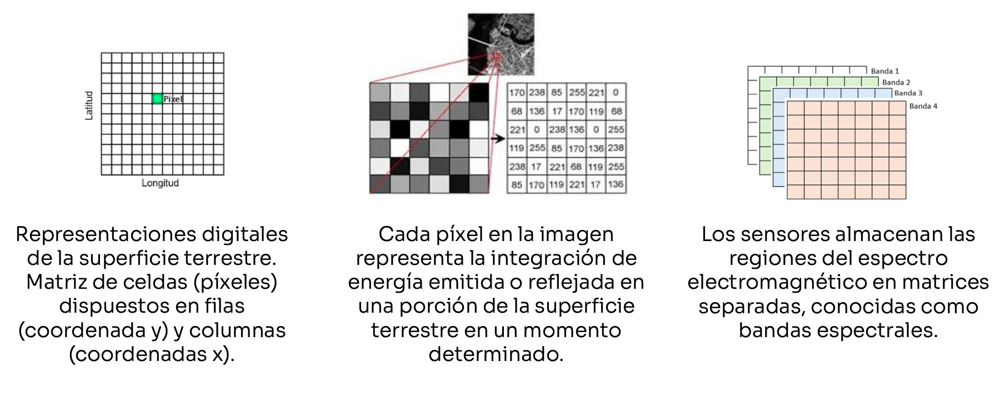

Una banda es una ventana de medición: registra energía en una parte del espectro. El color que vemos en pantalla es una forma de mostrar esos valores, no necesariamente el color real de la superficie.

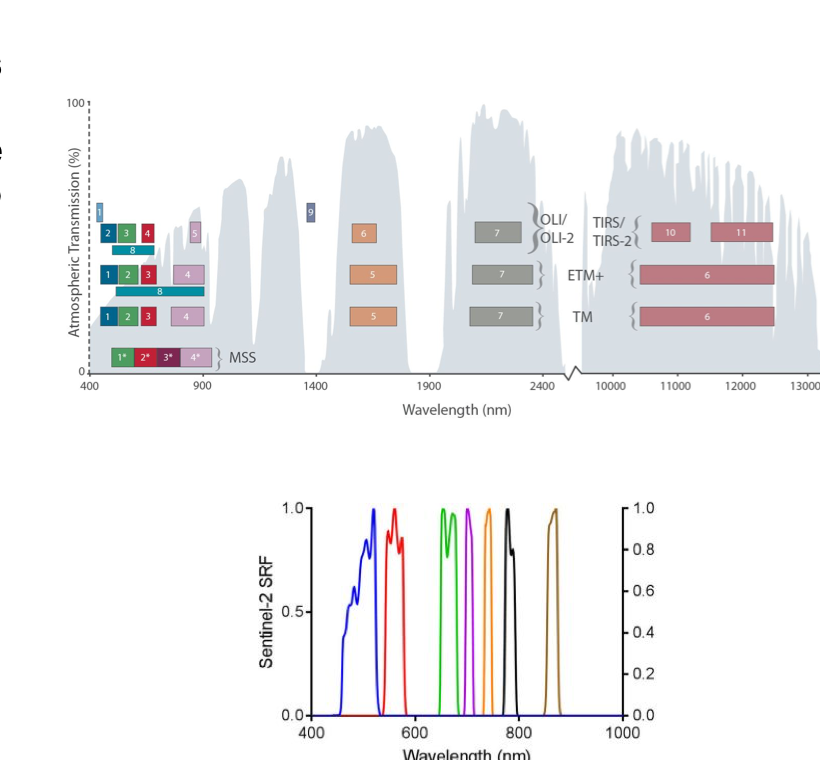

### 2. La escala define qué podemos distinguir

Para interpretar una imagen hay que preguntar cuánto terreno representa un píxel. Una imagen de dron puede mostrar detalles finos en un sector acotado; un satélite cubre áreas mayores y vuelve a observarlas en otras fechas, pero cada píxel puede mezclar varios elementos del terreno.

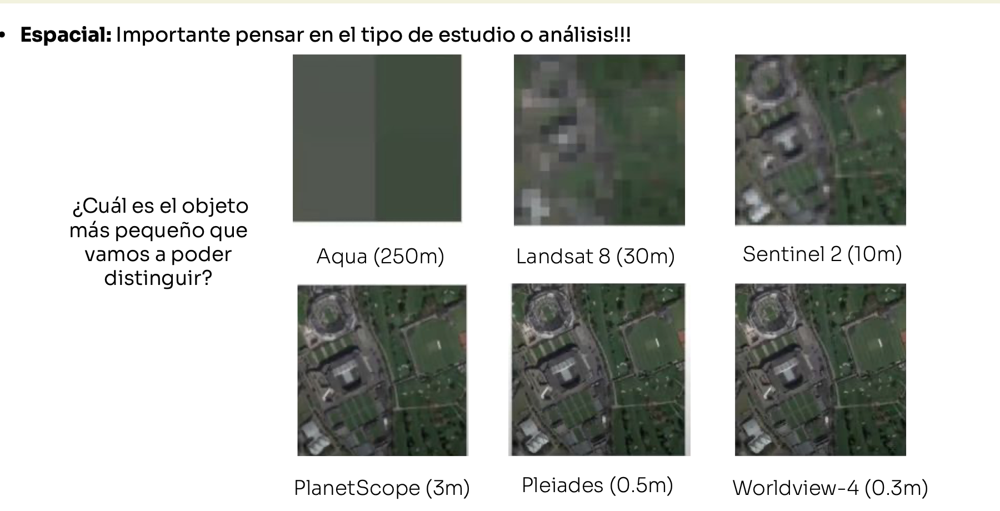

Dimensiones del archivo, extensión cubierta y resolución espacial son cosas distintas. Saber que una imagen tiene muchos píxeles no basta para saber qué tamaño de terreno representa cada uno.

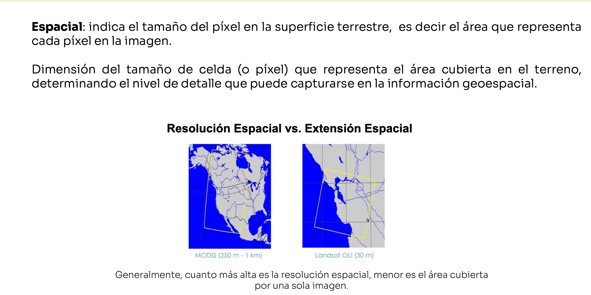

El vuelo del dron permite acercarse a la escala de las hileras y de las plantas. Para construir una imagen continua del lote se combinan fotografías solapadas y se genera un **ortomosaico**. La ubicación del resultado debe revisarse: un conjunto de fotos no es automáticamente un mapa georreferenciado preciso.

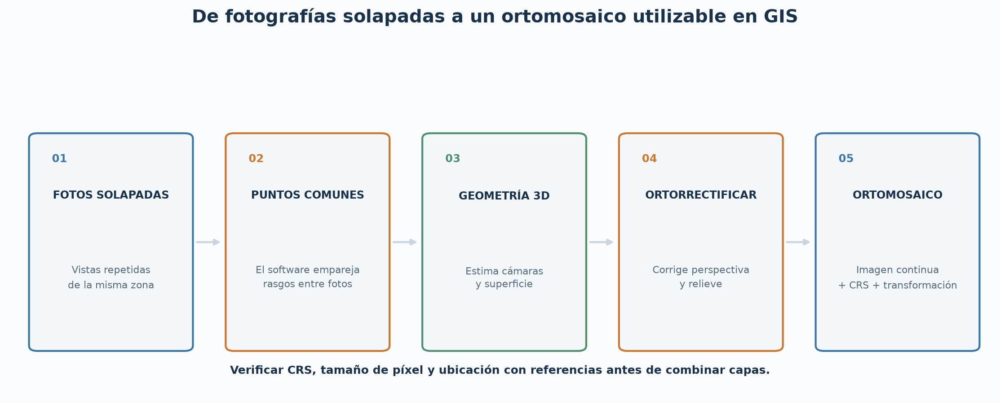

**Idea clave:** primero preguntamos qué objeto o patrón queremos distinguir; luego elegimos una imagen cuya resolución permita observarlo.

### 3. Para combinar imágenes y mapas hay que saber dónde están

Una imagen ráster representa valores en una cuadrícula. Una parcela suele representarse con un polígono vectorial. Para superponerlos correctamente, ambas capas deben estar ubicadas y expresadas en sistemas de referencia compatibles.

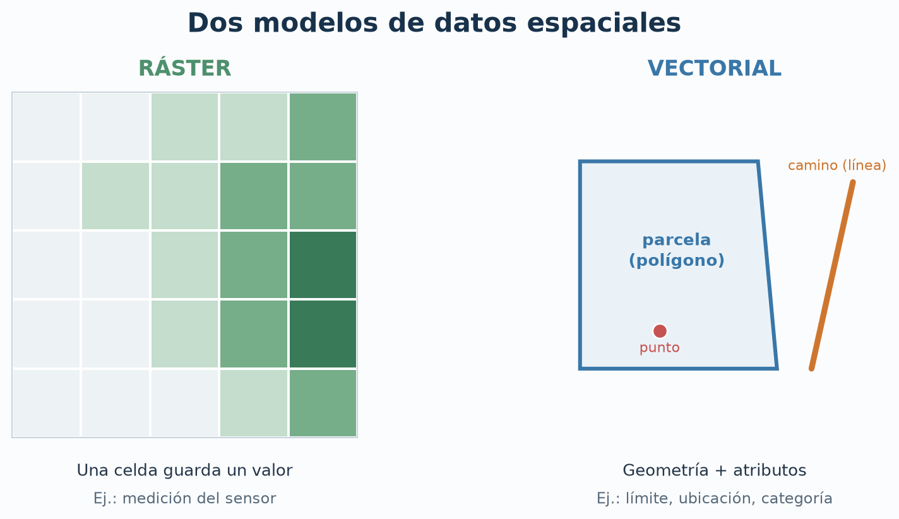

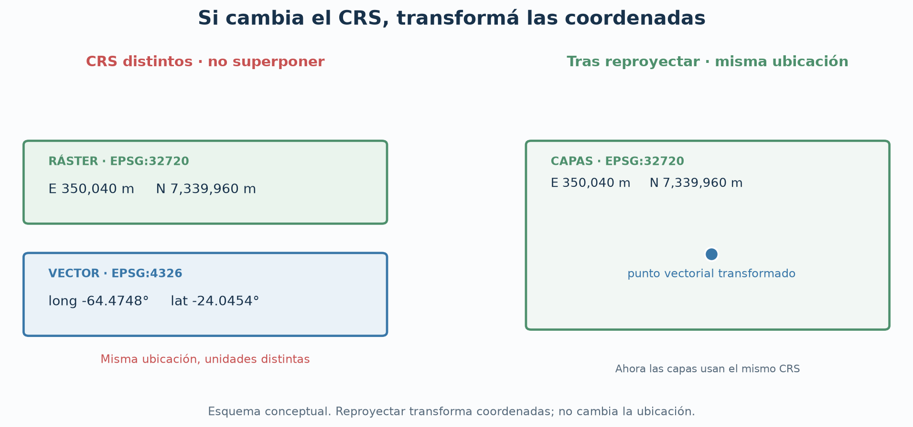

La ubicación geográfica conecta una observación en píxeles con un lugar que se puede encontrar y revisar. Antes de combinar capas se comprueba qué representa cada archivo, qué coordenadas utiliza y si su extensión y resolución sirven para la pregunta.

**Idea clave:** que dos capas se vean cerca no demuestra que estén alineadas correctamente; hay que revisar sus metadatos y referencia espacial.

### 4. De las bandas a una señal que ayude a observar

Las superficies no responden igual en todas las bandas. La vegetación, por ejemplo, suele reflejar de manera distinta la luz roja y el infrarrojo cercano. Un índice como NDVI compara esas bandas y resalta diferencias que pueden ser compatibles con cobertura vegetal.

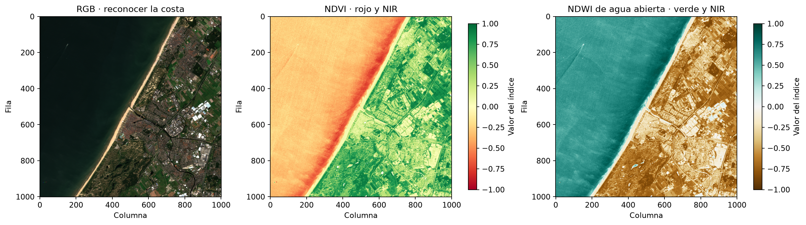

Un índice es una transformación de mediciones. Ayuda a explorar patrones, pero no nombra especies. Un valor alto no identifica maleza ni confirma que un cultivo esté sano. El resultado depende de las bandas, de la calidad de la escena, de la fecha y de lo que haya en el terreno.

**Idea clave:** un índice puede orientar dónde mirar; la interpretación agronómica requiere contexto y verificación.

### 5. La pregunta determina qué tipo de modelo necesitamos

Si queremos asignar una categoría a toda una imagen, el problema es clasificación de imagen. Si queremos una categoría para cada píxel, necesitamos segmentación semántica. Si queremos separar cada objeto, hablamos de segmentación por instancia; para localizar objetos con cajas, usamos detección.

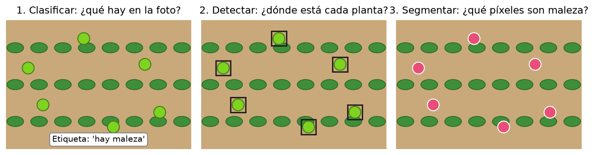

Una máscara es un mapa de etiquetas alineado con la imagen: a cada píxel se le asigna una clase. La máscara depende de cómo se definieron y verificaron las etiquetas. Una regla por color puede separar verde de no verde, pero no sabe si el verde corresponde a cultivo o a maleza.

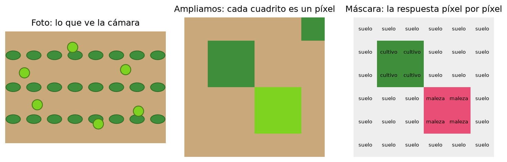

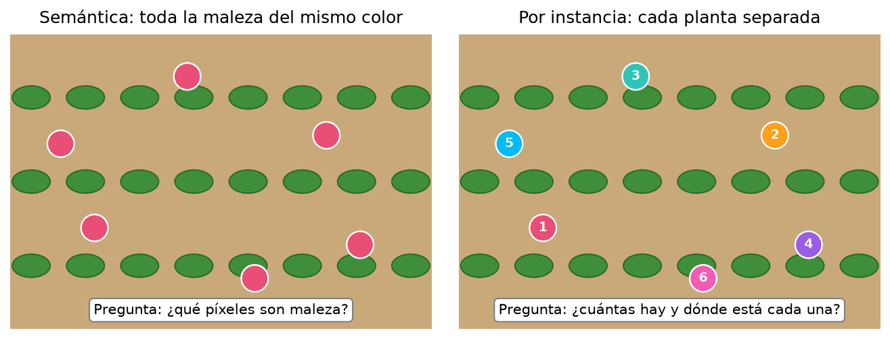

**Idea clave:** elegimos el modelo por la salida que requiere la decisión. Que un sistema marque vegetación no quiere decir que identifique la especie.

### 6. Una propuesta se compara con una referencia

Un modelo produce una propuesta. Para saber cómo funciona, la comparamos con una referencia verificada. En la comparación aparecen aciertos, zonas marcadas de más y zonas que el modelo dejó sin marcar.

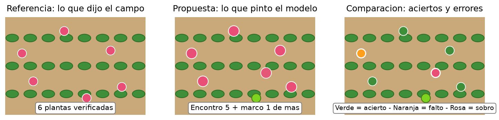

IoU resume cuánto se superponen la propuesta y la referencia. Precisión ayuda a entender cuánto de lo marcado era correcto; recall, cuánto de lo que debía encontrarse fue recuperado. En el campo, esos errores tienen costos distintos: una alerta falsa puede generar una revisión innecesaria y una omisión puede dejar un sector sin inspeccionar.

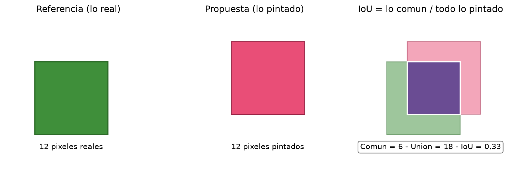

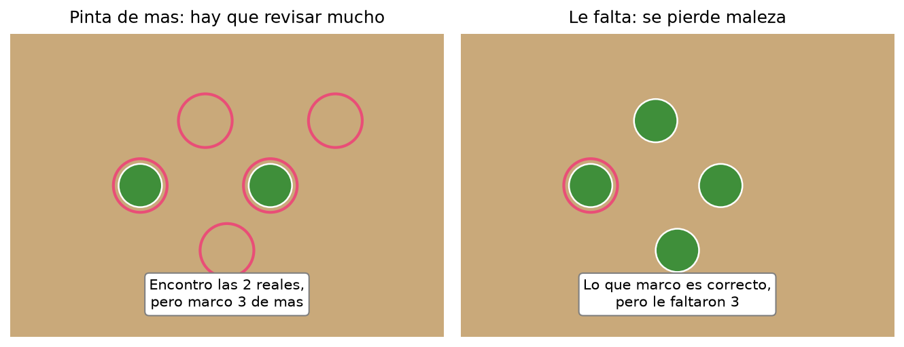

Una métrica no sirve sin saber qué clase se evaluó, con qué referencia y en qué condiciones. Un resultado bueno en una imagen no garantiza el mismo rendimiento en otra fecha, lote, iluminación o resolución.

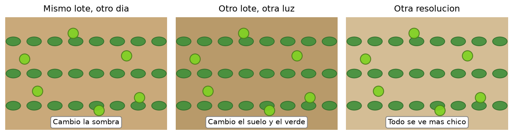

**Idea clave:** medir es comparar con una referencia; para decidir si el modelo sirve, también importa qué error resulta más costoso.

### El recorrido completo

Las clases anteriores se conectan en una cadena:

**Pregunta del campo → imagen y resolución → ubicación y capas GIS → bandas e índices → clasificación/detección/segmentación → comparación con referencia y métricas → revisión antes de actuar.**

Cada paso limita al siguiente. Una imagen inadecuada limita lo que puede observarse; un índice no decide qué especie hay; un modelo produce una propuesta; la referencia y la revisión humana permiten valorar esa propuesta.

---

## Segunda parte — Encontrar y explorar imágenes satelitales

### ¿Qué herramienta sirve para cada parte del trabajo?

Pensemos en una pregunta concreta: **¿qué cambió en la cobertura de un lote entre dos momentos?** Antes de calcular un índice o llamar a un modelo, necesitamos localizar imágenes que correspondan al lugar, las fechas y la escala que nos interesan.

El trabajo se puede contar como una secuencia:

**Pregunta del campo → definir lugar y fechas → buscar observaciones → inspeccionar escenas → comparar o procesar → guardar o compartir el resultado.**

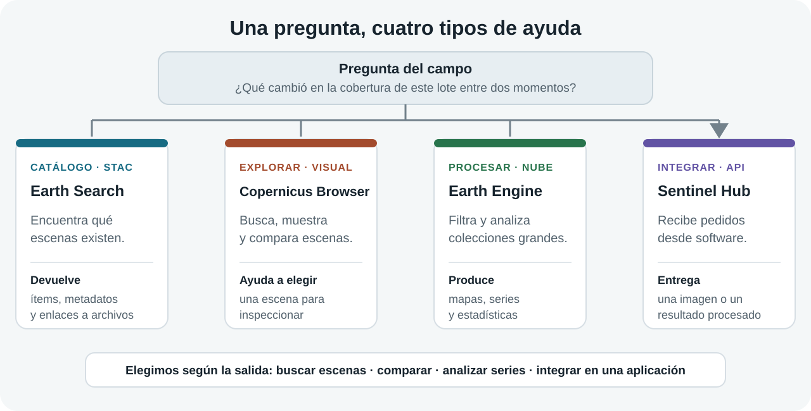

No todas las plataformas hacen lo mismo. Algunas describen y enumeran escenas; otras ayudan a mirarlas; otras ejecutan análisis sobre colecciones grandes; y otras entregan datos procesados a una aplicación.

| Necesidad | Herramienta | Qué hace | Qué resultado esperamos |
|---|---|---|---|
| Encontrar qué escenas existen para un lugar y una fecha. | **Earth Search**, mediante STAC. | Busca registros de escenas y expone sus metadatos y enlaces a archivos. | Una lista de observaciones posibles para revisar. |
| Mirar una zona en un mapa, comparar fechas y probar visualizaciones. | **Copernicus Browser**. | Ofrece una interfaz visual para buscar, inspeccionar y comparar datos satelitales. | Una escena seleccionada y una visualización para interpretar. |
| Repetir un análisis sobre muchas fechas o áreas sin descargar primero toda la colección. | **Google Earth Engine**. | Ejecuta operaciones sobre catálogos geoespaciales en la nube. | Un mapa, una serie temporal, una estadística o una exportación. |
| Pedir una imagen o un cálculo desde otra aplicación. | **Sentinel Hub**. | Ofrece servicios y API que buscan, procesan y devuelven datos de observación de la Tierra. | Una imagen, estadísticas u otro producto solicitado por software. |

Se pueden usar juntas, pero no son cuatro nombres para la misma función. Una comparación útil es pensar en una biblioteca: **Earth Search es el catálogo de fichas; Copernicus Browser es la mesa de consulta con el mapa; Earth Engine es el espacio de trabajo donde se procesa una colección; Sentinel Hub es un servicio que entrega un resultado cuando una aplicación lo solicita.**

### 1. Primero formulamos la búsqueda

Para buscar una escena hay que convertir la pregunta en criterios que una herramienta pueda utilizar:

- **Lugar:** ¿qué parcela o zona vamos a observar? En el Browser se puede centrar el mapa y dibujar un área de interés. El límite dibujado para la clase es aproximado y no reemplaza un límite catastral.
- **Tiempo:** ¿qué fechas o período responden la pregunta? Dos imágenes de estaciones distintas pueden verse diferentes por el ciclo del cultivo, aunque no haya ocurrido el cambio que suponemos.
- **Fuente y producto:** ¿qué sensor y nivel de procesamiento necesitamos? En esta exploración vamos a mirar Sentinel-2 L2A.
- **Calidad:** ¿hay nubes, sombras, neblina o píxeles faltantes sobre el lote? Un porcentaje bajo de nubes para toda una escena no garantiza que nuestro lote esté despejado.
- **Salida:** ¿nos alcanza con una vista para conversar o necesitamos datos geográficos para analizarlos en GIS?

**Pregunta para el grupo:** si queremos comparar dos fechas del mismo lote, ¿qué tendríamos que mantener parecido para que la comparación sea razonable? Buscamos lugar, temporada, tipo de producto y calidad de observación comparables.

### 2. Earth Search: localizar registros y archivos

Earth Search es un catálogo accesible mediante la API STAC. Su trabajo principal es describir y encontrar observaciones. El catálogo organiza las colecciones, y cada **ítem** representa una observación concreta con su geometría, fecha y propiedades. Los **assets** son los enlaces a archivos relacionados, por ejemplo bandas, una vista previa o metadatos adicionales.

Una ficha STAC responde preguntas como estas:

| Parte de la ficha | Pregunta que responde |
|---|---|
| Identificador y colección | ¿Qué observación es y a qué conjunto pertenece? |
| Geometría o extensión | ¿Qué zona cubre? |
| Fecha y hora | ¿Cuándo se capturó? |
| Propiedades | ¿Qué información de calidad o del sensor acompaña la escena? |
| Assets | ¿Qué archivos o bandas se pueden consultar? |

La respuesta suele ser JSON: es información estructurada para que una persona o un programa encuentre los datos. El catálogo no calcula NDVI ni decide si en la escena hay malezas. Con Python, una librería como **pystac-client** automatiza la consulta: le damos área, fecha y colección; recibimos ítems para revisar y, según el catálogo, enlaces a los assets.

Para la demostración, abrí la [lista de colecciones de Earth Search](https://earth-search.aws.element84.com/v1/collections) y la [documentación de su API STAC](https://earth-search.aws.element84.com/v1/api.html). Señalá una colección y después un ítem. La idea no es memorizar JSON, sino reconocer que **buscar escenas** y **procesar sus píxeles** son tareas distintas.

### 3. Copernicus Browser: inspeccionar escenas a simple vista

El Browser es la herramienta visual principal de esta parte. Permite buscar una zona y un período, ver resultados sobre el mapa, consultar información de cada producto, probar visualizaciones y comparar escenas. En la documentación actual se indica que hace falta una cuenta gratuita; conviene comprobar el acceso antes de la clase.

*Referencia: [documentación oficial del Copernicus Browser](https://documentation.dataspace.copernicus.eu/Applications/Browser.html). La disposición exacta de la interfaz puede cambiar.*

*Referencia: [documentación oficial del Copernicus Browser](https://documentation.dataspace.copernicus.eu/Applications/Browser.html).*

#### Recorrido guiado

1. Abrí [Copernicus Browser](https://browser.dataspace.copernicus.eu/) y buscá una zona agrícola conocida o los alrededores de Mendoza.
2. Dibujá un área pequeña de interés. Decí en voz alta qué límite estás usando y qué tan confiable es: para esta observación basta un recorte aproximado, pero no se debe presentar como el límite oficial del lote.
3. Elegí Sentinel-2 L2A y definí un intervalo de fechas. Ajustá el filtro de nubosidad y observá cómo cambia la lista de resultados.
4. Antes de elegir una escena, mirá la fecha, la huella que cubre, la vista previa y la presencia de nubes o sombras en el área dibujada. Si la interfaz muestra nubosidad de escena, recordá que esa cifra resume una zona mucho mayor que el lote.
5. Mostrá primero **True Color**. Preguntá: ¿qué vemos realmente y qué elementos no podemos identificar con seguridad?
6. Cambiá a **NDVI** y compará. Esta capa transforma las mediciones de bandas para resaltar diferencias compatibles con vegetación. El color que aparece depende de la visualización; no es una fotografía del terreno ni una etiqueta de especie.
7. Si hay más de una escena adecuada, compará las fechas lado a lado o con transparencia. Explicá qué diferencias pueden venir del terreno y cuáles de nubes, sombras, estación o condiciones de captura.

*Referencia: [documentación oficial del Copernicus Browser](https://documentation.dataspace.copernicus.eu/Applications/Browser.html).*

**Preguntas para guiar la observación:** ¿la escena cubre toda el área?, ¿qué fecha representa?, ¿la nube está sobre el lote o en otra parte de la escena?, ¿el patrón aparece en True Color y en NDVI?, ¿qué dato haría falta para afirmar que una zona es cultivo o maleza?

**Qué se llevan de esta herramienta:** el Browser sirve para explorar y justificar la elección de una escena. Encontrar una imagen que se vea bien es un primer filtro; no es una validación de campo ni una clasificación automática del lote.

### 4. Google Earth Engine: procesar colecciones en la nube

Earth Engine combina un catálogo grande de datos geoespaciales con herramientas para procesarlos en servidores remotos. En lugar de descargar muchas escenas a la computadora y analizarlas una por una, escribimos una consulta que filtra por lugar y fechas y luego aplica operaciones. El resultado puede mostrarse en un mapa, resumirse como valores o exportarse.

*Referencia: [guía oficial del Code Editor de Earth Engine](https://developers.google.com/earth-engine/guides/playground).*

Leé la interfaz como tres espacios conectados: a un lado se buscan datos y se escriben instrucciones; en el centro se ven las capas; en los paneles de salida aparecen mensajes, valores, gráficos y tareas de exportación. El código indica qué datos consultar y qué operaciones aplicar; el cálculo ocurre en la nube y el mapa o los resultados vuelven al navegador.

**Ejemplo para explicar en clase:** en Copernicus Browser seleccionamos manualmente una escena y la miramos. En Earth Engine podríamos pedir todas las escenas de un lote durante un período, filtrarlas, formar un compuesto con varias observaciones y resumir cómo varía un índice. La computadora local no necesita guardar primero cada escena completa.

**Dynamic World** es un ejemplo concreto para distinguir plataforma y producto. Es un conjunto de mapas de cobertura derivado de imágenes Sentinel-2 y se puede explorar en una aplicación pública. Sus categorías son generales —por ejemplo, agua, árboles, vegetación, cultivos o superficie construida—; no es una capa que identifique malezas en nuestro lote. La aplicación deja ver un resultado preparado; Earth Engine permite construir otros análisis sobre colecciones y períodos.

El Code Editor requiere registro y configuración de un proyecto de Google Cloud para ejecutar flujos. Para esta clase alcanza con reconocer la interfaz y usar [Dynamic World](https://dynamicworld.app/explore) como muestra de un producto publicado. No necesitamos configurar un proyecto ni programar el análisis.

**Pregunta para el grupo:** si el Browser alcanza para comparar dos escenas, ¿qué ventaja aparecería al analizar cientos de lotes durante varios años? Buscamos automatización, repetición y resumen de muchas observaciones; también aparece el trabajo de definir y revisar un flujo reproducible.

### 5. Sentinel Hub: entregar imágenes y análisis a otras aplicaciones

Sentinel Hub ofrece servicios y APIs para pedir productos de observación de la Tierra. Una aplicación puede enviar parámetros como el área, la fecha, la colección, las bandas y la forma de visualizar o calcular los datos. El servicio busca las observaciones disponibles, ejecuta el procesamiento solicitado y devuelve una imagen, estadísticas u otra salida.

Una forma práctica de explicarlo es con una aplicación agrícola: una persona abre un lote en el mapa y la aplicación pide una capa de NDVI para una fecha. El software no necesita que alguien abra cada escena a mano; arma una solicitud y recibe el resultado para mostrarlo o guardarlo.

Copernicus Browser y Sentinel Hub se relacionan, pero cumplen papeles distintos para nosotros: **Copernicus Browser es una interfaz de exploración; Sentinel Hub es un conjunto de servicios de acceso y procesamiento que también permite integrar esos datos en software.** El Browser de Copernicus está basado en EO Browser, una aplicación del ecosistema Sentinel Hub. Esa relación no convierte al catálogo STAC de Earth Search, a Earth Engine y a Sentinel Hub en una única herramienta.

**Pregunta para el grupo:** si un mapa de nuestra aplicación debe mostrar automáticamente una imagen para cada lote y fecha, ¿conviene que una persona busque y descargue cada escena manualmente o que el sistema solicite el producto a un servicio? ¿Qué habría que registrar para poder repetir la solicitud?

### 6. Elegimos herramienta según el resultado que necesitamos

- **Quiero encontrar una escena y mirar si sirve:** empiezo por Copernicus Browser.
- **Quiero consultar por código qué escenas cumplen área, fecha y colección:** uso un catálogo STAC como Earth Search y automatizo la consulta con pystac-client.
- **Quiero repetir cálculos sobre muchas fechas, zonas o colecciones:** considero Google Earth Engine.
- **Quiero que una aplicación reciba una imagen o estadísticas mediante una solicitud:** considero las APIs de Sentinel Hub.

**Idea clave:** un catálogo responde “¿qué observaciones hay?”; un navegador ayuda a responder “¿cuál escena se ve adecuada?”; una plataforma de análisis responde “¿qué patrón se repite en muchas observaciones?”; un servicio integrado responde “¿cómo obtiene mi aplicación el producto que necesita?”.

### Lo que la imagen permite afirmar y lo que no

Una imagen satelital ayuda a observar patrones amplios y cambios entre fechas. La resolución espacial limita los detalles: a esta escala no debemos prometer identificar plantas individuales. Nubes, sombras, suelo, estación y diferencias de captura también afectan lo que vemos.

NDVI ayuda a explorar diferencias relacionadas con vegetación; **no identifica especies, no confirma malezas y no sustituye la verificación de campo**. Si descargamos una imagen básica para una presentación, sirve para comunicar una vista. Para analizar valores y ubicaciones en GIS hace falta revisar las opciones analíticas y comprobar formato, resolución, bandas y referencia espacial del archivo descargado. Una captura o un PNG/JPG no equivalen automáticamente a un ráster analítico.

**Cierre con una decisión:** cada grupo propone una escena para una pregunta concreta y justifica la elección con lugar, fecha, producto, calidad y escala. Después indica qué podría analizar con esa imagen, qué no puede concluir y qué herramienta usaría si tuviera que repetir el trabajo muchas veces.

### Fuentes oficiales y referencias visuales

- [Copernicus Browser: guía y descripción de la interfaz](https://documentation.dataspace.copernicus.eu/Applications/Browser.html)
- [Earth Search: API STAC](https://earth-search.aws.element84.com/v1/api.html) y [colecciones disponibles](https://earth-search.aws.element84.com/v1/collections)
- [Especificación STAC](https://stacspec.org/)
- [Google Earth Engine: Code Editor](https://developers.google.com/earth-engine/guides/playground)
- [Google Earth Engine: catálogo y descripción de Dynamic World](https://developers.google.com/earth-engine/datasets/catalog/GOOGLE_DYNAMICWORLD_V1)
- [Sentinel Hub: descripción de sus APIs](https://docs.sentinel-hub.com/api/latest/api/overview/) y [guía de EO Browser](https://www.sentinel-hub.com/explore/eobrowser/user-guide/)
