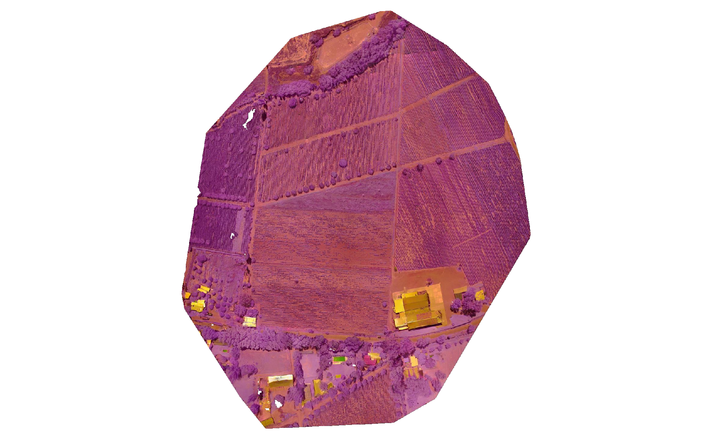
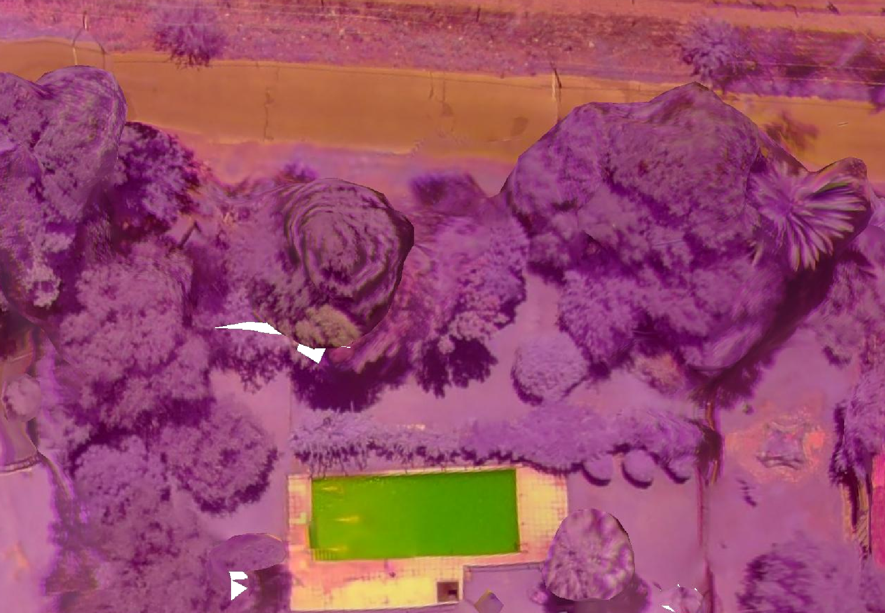
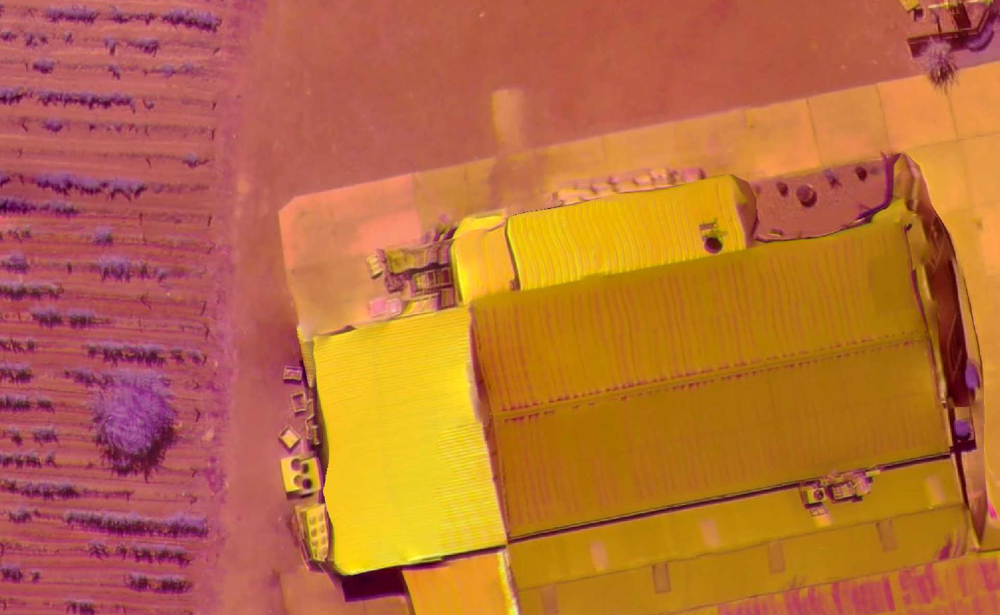

# Clase 7 — Dibujar máscaras manuales con QGIS

## Crear polígonos sobre una imagen aérea

**Duración:** 2 horas · **Versión de referencia:** QGIS 3.44.15 en macOS

## La tarea de hoy

Vas a usar QGIS para dibujar **tres polígonos sobre la imagen**: uno alrededor del agua de una pileta, otro sobre un techo y otro alrededor de un cuadro donde se ven hileras de vegetación. Los guardarás en una capa propia, les darás colores distintos y comprobarás que se pueden mostrar junto con la imagen.

En esta clase, “máscara” quiere decir **un contorno que dibujamos a mano para marcar una zona visible**. Es un polígono vectorial. No es una máscara de píxeles creada por un modelo y no clasifica automáticamente la imagen. Hoy practicamos el manejo de QGIS: crear una capa, dibujar y corregir formas, cambiar su aspecto y guardarlas.

### Recorrido de 2 horas

| Tiempo | Qué vas a hacer |
|---|---|
| 0–10 min | Entender la tarea y distinguir imagen de polígono. |
| 10–20 min | Ubicarte en QGIS y navegar hasta la zona elegida. |
| 20–40 min | Crear una capa de polígonos con campos simples. |
| 40–55 min | Dibujar en conjunto el primer polígono: la pileta. |
| 55–70 min | Dibujar el polígono del techo. |
| 70–90 min | Dibujar el polígono del cuadro con hileras de vegetación. |
| 90–100 min | Revisar las formas y guardar los cambios. |
| 100–115 min | Colorear las categorías y revisar la tabla. |
| 115–120 min | Mostrar el resultado y explicar qué archivo creaste. |

## 1. Abrí el mapa y ubicá las capas

1. Abrí el proyecto [practica_qgis_clase_07.qgz](../../media/clase_07/practica_qgis_clase_07.qgz).
2. Conservá la carpeta `assets` del curso en la raíz del repositorio. La imagen de fondo está en [mendoza_agrocam_20190215.tif](../../assets/geospatial/mendoza_agrocam_20190215.tif).
3. En el panel **Capas** debe aparecer `mendoza_agrocam_20190215`. Esa es la imagen ráster: una grilla de píxeles que usamos como fondo.
4. Si la imagen no entra completa en la pantalla, hacé clic en **Zoom general**.

La escena está en **falso color**: el verde y el violeta de la pantalla no son los colores que veríamos desde el suelo. Para encontrar la pileta, fijate en su forma rectangular y en el piso que la rodea, no solo en el color. Es una referencia visual para practicar el dibujo.

### ¿Qué es una capa?

Una capa es un tipo de información que QGIS puede mostrar sobre el mapa. En esta práctica vas a tener:

- **La capa ráster:** la fotografía aérea.
- **Tu capa vectorial:** los polígonos que vas a dibujar encima.

El proyecto `.qgz` guarda la organización de la vista y las rutas de los datos. El archivo `.gpkg` que vas a crear guarda tu nueva capa y sus formas. Guardar el proyecto y guardar las formas son dos acciones diferentes.

## 2. Conocé los movimientos básicos

| Herramienta | Cómo se usa | Para qué sirve |
|---|---|---|
| **Desplazar mapa** | Elegila y arrastrá el mapa. | Mover la vista sin cambiar los datos. |
| **Acercar zoom** | Elegila y dibujá un rectángulo sobre la zona. | Ver mejor un detalle. |
| **Alejar zoom** | Elegila y hacé clic en el mapa. | Recuperar contexto. |
| **Zoom general** | Hacé clic en el botón de la lupa con flechas hacia afuera. | Volver a encuadrar la imagen completa. |

Usá **Acercar zoom** para ir primero a la pileta —está cerca de las casas, en la parte inferior de la imagen— y después al conjunto de techos amarillos. Las siguientes figuras muestran los detalles que vas a dibujar:

La imagen está georreferenciada, así que QGIS puede ubicar la capa vectorial en el mismo espacio que el ráster. En la barra inferior se ve `EPSG:32619`. No hace falta cambiar ese valor: al crear la capa, vamos a elegir el mismo sistema de referencia del proyecto.

## 3. Creá una capa para tus polígonos

La capa debe existir antes de dibujar. Vamos a crearla en formato GeoPackage, un archivo que puede guardar formas y los datos escritos sobre ellas.

1. Elegí **Capa → Crear capa → Nueva capa GeoPackage…**.
2. En **Base de datos**, indicá una carpeta tuya donde puedas guardar archivos. Por ejemplo, creá `Documentos/Clase07_QGIS` y nombrá el archivo `mascaras_clase07.gpkg`.
3. En **Nombre de tabla**, escribí `mascaras`.
4. En **Tipo de geometría**, elegí **Polígono**. No actives dimensiones Z ni M.
5. En **SRC**, elegí el del proyecto: `EPSG:32619`.
6. En **Nuevo campo**, agregá estos campos de texto. Después de cada uno, apretá **Añadir a la lista de campos**.

   | Nombre | Tipo | Para qué lo usás |
   |---|---|---|
   | `clase` | Texto | Escribir `agua`, `construido` o `vegetacion`. |
   | `nota` | Texto | Aclarar qué contorneaste. |

7. Presioná **Aceptar**. En el panel **Capas** aparecerá `mascaras`. Tiene que quedar arriba de la imagen; si aparece debajo, arrastrala encima de `mendoza_agrocam_20190215`.

Si la ventana se ve distinta, comprobá estos cuatro datos antes de aceptar: archivo GeoPackage, tabla `mascaras`, geometría **Polígono** y SRC `EPSG:32619`.

## 4. Hacé una prueba corta en la pileta

Primero vamos a trazar una sola forma. El objetivo es practicar los clics y el guardado antes de dibujar el segundo polígono.

1. En **Capas**, seleccioná `mascaras`.
2. Activá **Conmutar edición** con el botón del lápiz o desde el menú contextual de la capa.
3. Elegí la herramienta **Añadir polígono**.
4. Acercate a la pileta usando **Acercar zoom**.
5. Hacé un clic en cada esquina del borde interior del agua. Para una forma rectangular, cuatro esquinas suelen alcanzar.
6. Al terminar, hacé clic derecho (o usá el clic secundario del trackpad). Se cierra el contorno y aparece una ficha.
7. En la ficha, escribí `agua` en `clase` y `Pileta trazada a mano` en `nota`. Aceptá.

**Pausa para mirar:** ¿el polígono sigue el borde del agua o también cubre el piso que lo rodea? Si incluye mucho piso, corregilo antes de continuar.

### Si te equivocás

- Mientras dibujás, presioná **Esc** para cancelar la forma que todavía no terminaste.
- Si ya la terminaste, usá **Edición → Deshacer** (`⌘Z`) y volvé a dibujarla.
- Al dibujar, usá pocos vértices bien ubicados. Agregar muchos clics no mejora necesariamente el contorno.

## 5. Dibujá el segundo polígono

Ahora vas a repetir el mismo procedimiento sobre **una sola cubierta** del conjunto de techos.

1. Volvé a usar **Acercar zoom** para ver el conjunto.
2. Confirmá que `mascaras` siga seleccionada y en modo edición.
3. Elegí **Añadir polígono**.
4. Hacé clic en las esquinas de una cubierta amarilla rectangular. Cerrá con clic derecho o con el clic secundario del trackpad.
5. En la ficha, escribí `construido` en `clase` y `Techo trazado a mano` en `nota`. Aceptá.

No dibujes alrededor de todo el predio. Seguí el contorno de una cubierta y dejá afuera el suelo, los árboles y las sombras.

## 6. Ejercicio extra: delimitá un cuadro con vegetación en hileras

Volvé a la vista completa y acercate a uno de los cuadros agrícolas donde se ven muchas líneas paralelas. Elegí un cuadro reconocible por sus hileras y recorré **su borde exterior**: no hace falta dibujar cada planta ni cada línea.

1. Confirmá que `mascaras` siga seleccionada y en modo edición.
2. Elegí **Añadir polígono** y hacé clic en las esquinas del cuadro. Si el borde cambia de dirección, agregá un vértice; unos pocos puntos alcanzan.
3. Cerrá la forma con clic derecho o clic secundario.
4. En la ficha, escribí `vegetacion` en `clase` y `Cuadro con hileras visibles` en `nota`. Aceptá.

La forma representa **el sector que elegiste**, no cada hoja ni cada píxel de vegetación. En esta imagen practicamos a delimitar una zona visible; no estamos identificando especies ni separando cultivo de malezas.

**Pregunta para mirar el resultado:** ¿qué parte de la imagen usaste para decidir dónde terminaba el cuadro: las hileras, el cambio de textura o el borde del terreno?

## 7. Revisá y guardá las formas

### Encendé y apagá la máscara

En el panel **Capas**, apagá la casilla de `mascaras` y volvé a encenderla. La imagen debe seguir visible y los tres polígonos deben aparecer o desaparecer juntos. Esto cambia lo que mostrás, no borra las formas.

### Corregí un vértice si hace falta

Con la edición activa, elegí la **Herramienta de vértices**. Hacé clic sobre un polígono y arrastrá uno de sus vértices para acercarlo al borde visible. Esta acción mueve un punto de la forma; no mueve la imagen.

### Guardá las formas

1. En **Capas**, seleccioná `mascaras` y hacé clic en **Conmutar edición**.
2. Cuando QGIS pregunte, elegí **Guardar** los cambios.
3. Si corregiste algún vértice después, volvé a guardar antes de continuar.

## 8. Coloreá las categorías y comprobá el resultado

QGIS puede asignar un color a cada valor escrito en `clase`. Esto cambia cómo se ve la capa; no modifica los polígonos ni analiza la imagen.

1. Abrí **Propiedades** de la capa `mascaras`.
2. Entrá en **Simbología** y cambiá el tipo de representación a **Categorizado**.
3. En **Valor**, elegí el campo `clase` y presioná **Clasificar**.
4. Asigná un color distinto a `agua`, `construido` y `vegetacion`. Elegí rellenos semitransparentes o bordes visibles para seguir viendo la imagen debajo.
5. Presioná **Aplicar** y comprobá que cada polígono tenga el color de su categoría.

El color ayuda a leer las formas: no demuestra por sí solo qué representa cada zona.

Abrí la tabla de `mascaras` con **F6**. Tiene que haber tres filas: `agua`, `construido` y `vegetacion`. Confirmá también que el archivo `mascaras_clase07.gpkg` esté en tu carpeta. Si corregís la geometría después de guardar, activá la edición y volvé a guardar los cambios.

Si también cambiaste la vista del proyecto y querés conservarla, usá **Proyecto → Guardar**. Eso no reemplaza el guardado de la capa.

## Entrega final

Guardá un archivo `mascaras_clase07.gpkg` que contenga:

- **Un polígono** que siga el borde interior del agua de la pileta, con `clase = agua`.
- **Un polígono** que siga el borde de una cubierta visible, con `clase = construido`.
- **Un polígono** alrededor de un cuadro con hileras visibles, con `clase = vegetacion`.
- Una nota breve para cada forma y un color distinto para cada categoría.
- La capa `mascaras` dibujada sobre la imagen y guardada.

Antes de cerrar, completá esta revisión:

| Comprobación | Listo |
|---|---|
| Puedo ocultar y volver a mostrar `mascaras`. | ☐ |
| El polígono de la pileta no cubre todo el patio. | ☐ |
| El polígono del techo no incluye árboles ni suelo. | ☐ |
| El polígono de vegetación rodea un cuadro, no cada planta. | ☐ |
| La tabla tiene las tres clases y sus notas. | ☐ |
| Cada clase se muestra con un color distinto. | ☐ |
| Guardé la capa en un archivo `.gpkg`. | ☐ |

### Contalo en una frase

> “En QGIS creé la capa ___, dibujé ___, ___ y ___, y guardé el resultado en ___.”

## Recomendaciones

1. Acercate antes de empezar a dibujar y volvé a **Zoom general** para recuperar el contexto.
2. Seleccioná la capa correcta antes de activar la edición. La edición afecta a la capa seleccionada.
3. Dibujá pocos vértices, en el borde del objeto y sin intentar seguir cada irregularidad pequeña.
4. Guardá la capa al salir del modo de edición; guardar el proyecto no guarda automáticamente los polígonos.
5. Recordá que estos son **contornos manuales para practicar**. No son una detección automática ni una máscara de píxeles producida por un modelo.

## Referencias

- Imagen de Mendoza publicada en [OpenAerialMap](https://imagery.hotosm.org/browse?lat=-33.0513&lon=-68.8196&zoom=16.8&selected_id=5c68285a00b30100059fc421), licencia [CC BY 4.0](https://creativecommons.org/licenses/by/4.0/).
- Manual oficial: [crear una capa GeoPackage](https://docs.qgis.org/3.44/en/docs/user_manual/managing_data_source/create_layers.html).
- Manual oficial: [editar geometrías y dibujar objetos](https://docs.qgis.org/3.44/en/docs/user_manual/working_with_vector/editing_geometry_attributes.html).
- Manual oficial: [interfaz de QGIS](https://docs.qgis.org/3.44/en/docs/user_manual/introduction/qgis_gui.html).

## Ejercicio complementario

Para practicar cómo se crea una máscara ráster a partir de polígonos, seguí el [ejercicio guiado con la muestra de maíz y malezas](ejercicio_segmentacion_maiz_maleza_qgis.md). Es un bloque complementario de 50–60 minutos.
