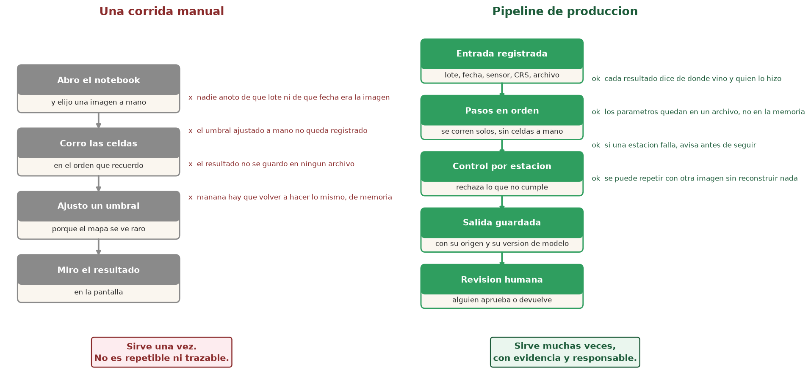
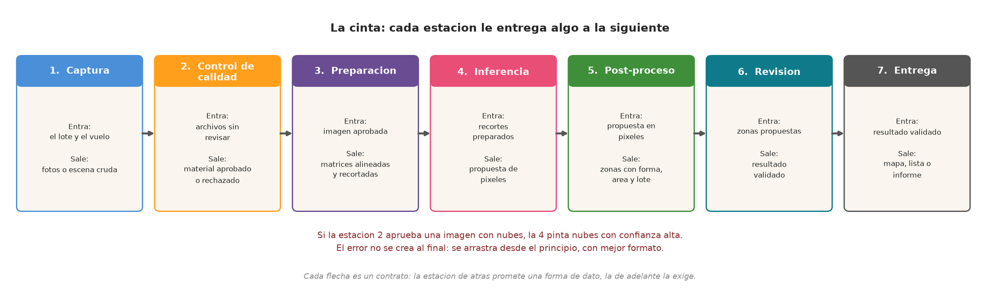
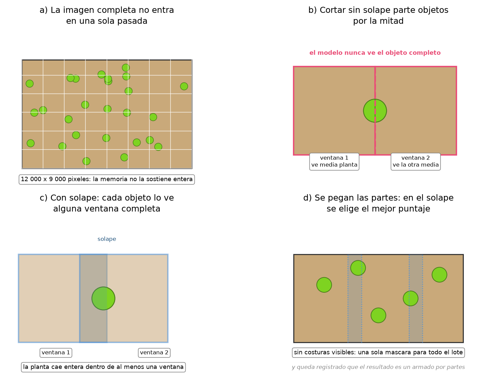
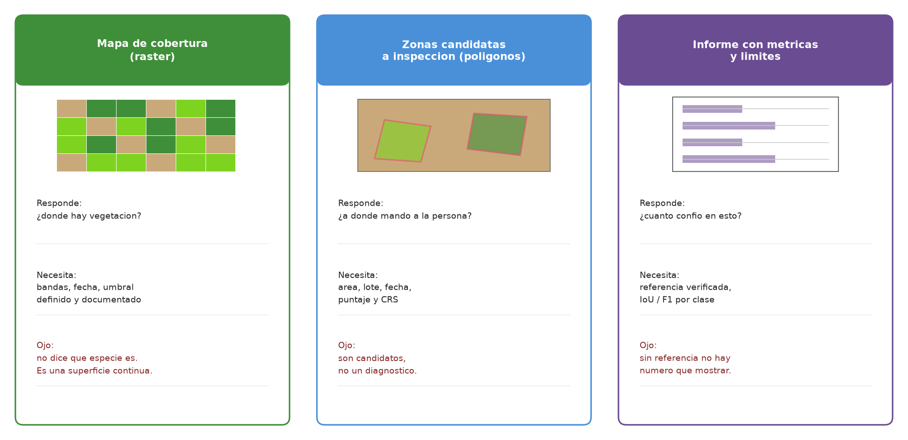
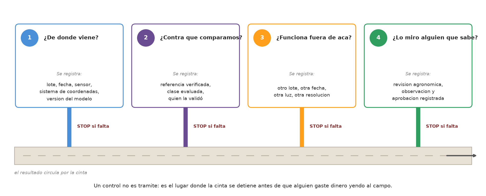
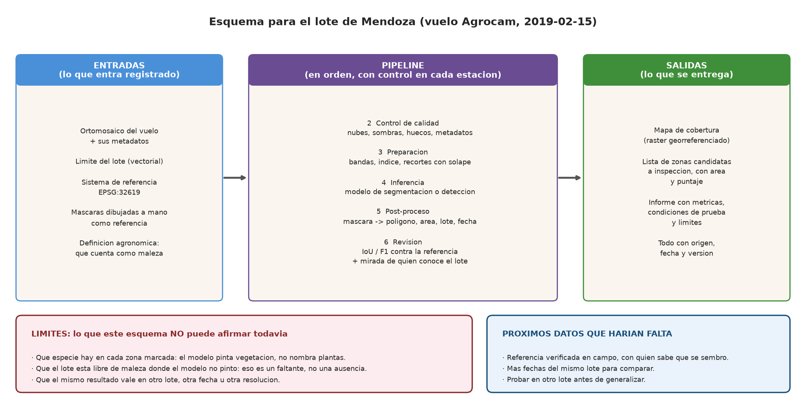

# Clase 8 — La cinta completa: de la foto aérea al dato que llega al campo

**Duración:** 2 horas · **Sin computadora:** hoy trabajamos con figuras, papel y lápiz.

## De qué trata esta clase

En las siete clases anteriores aprendimos piezas sueltas: qué es un píxel, cómo se ubica una imagen en el mapa, qué hace un índice, qué pinta un modelo de segmentación y cómo se mide si pintó bien. Hoy juntamos todas las piezas en una sola fila.

Esa fila se llama **pipeline**. En la industria no significa "un script largo": significa **un recorrido ordenado, con control en cada paso, que se puede repetir mañana con otra imagen sin que nadie tenga que acordarse de cómo se hizo**.

La pregunta que cerrará el módulo no es técnica. Es:

> Un productor te pregunta mañana a la mañana: *"¿en qué parte del lote mando a revisar malezas?"*.
> ¿Qué tenés que haber hecho antes para poder contestarle con algo que no sea una corazonada?

Eso es lo que construye un pipeline.

## Términos que vamos a usar

| Término | Qué significa en esta clase |
|---|---|
| **Pipeline** | El recorrido completo, ordenado y controlado, desde la imagen hasta el resultado entregado. |
| **Estación** | Cada paso del recorrido. Tiene una entrada, una salida y un control. |
| **Orquestación** | Definir el orden de las estaciones y qué pasa si una falla. Es el "director de orquesta": no toca ningún instrumento, pero sin él suenan todos a la vez. |
| **Trazabilidad** | Poder reconstruir, mirando los registros, de dónde salió cada número o cada zona marcada. |
| **Repetible** | Que la misma corrida dé el mismo resultado con la misma entrada. |
| **Inferencia** | Pasarle imágenes al modelo ya entrenado para que proponga qué pintar. |
| **Post-proceso** | Convertir la propuesta en píxeles en algo útil: zonas, áreas, lotes, puntajes. |
| **Chips / ventanas** | Recortes chicos de una imagen grande que se procesan por separado. |
| **Solape** | La franja donde dos recortes se superponen a propósito. |
| **Referencia** | Lo que dijo el campo, verificado por alguien que sabe. |
| **Entregable** | El producto final que recibe quien va a tomar la decisión. |

---

## Recorrido de 2 horas

| Tiempo | Qué vas a hacer |
|---|---|
| 0–10 min | Juntar las siete clases anteriores en una sola cadena. |
| 10–25 min | Distinguir una corrida manual de un pipeline. |
| 25–50 min | Recorrer las siete estaciones: qué entra, qué sale, qué se controla. |
| 50–65 min | Entender por qué una imagen grande se procesa por partes. |
| 65–80 min | Comparar los tres entregables posibles. |
| 80–95 min | Los cuatro controles antes de entregar. |
| 95–115 min | **Ejercicio en papel:** armar el esquema del lote de Mendoza. |
| 115–120 min | Cierre: qué te llevás del módulo 3. |

---

## 1. Venimos de acá: las siete clases son una cadena

Antes de ver el pipeline completo, ubiquemos lo que ya sabemos. Cada clase respondió una pregunta:

| Clase | La pregunta | La respuesta |
|---|---|---|
| 1 | ¿Qué estoy mirando realmente? | Una imagen es una **medición**, no el terreno. Un píxel cubre un trozo de suelo. |
| 2 | ¿Dónde está eso en el mapa? | Hay que **ubicar** el ráster y el límite del lote en el mismo sistema de coordenadas. |
| 3 | ¿Qué señal me deja ver la vegetación? | Un **índice** combina bandas y resalta diferencias compatibles con cobertura. |
| 4 | ¿Qué tipo de respuesta necesito? | Clasificar, detectar o **segmentar**: se elige por la decisión, no por moda. |
| 5 | ¿Qué tan bien pinta? | Se compara con una **referencia** y se mide con IoU, precisión, recall y F1. |
| 6 | ¿Cómo consigo más imágenes sin descargar todo? | Con **catálogos y plataformas** que buscan y procesan colecciones. |
| 7 | ¿Cómo dibujo la referencia a mano? | Con **QGIS**, creando polígonos sobre la imagen. |

Notá algo: ninguna de esas clases, tomada sola, contesta la pregunta del productor. La clase 5 te da un número, pero no un mapa. La clase 7 te da un mapa, pero dibujado por vos. La clase 3 te da una señal, pero no una zona a la que mandar a alguien.

**El pipeline es lo que las ordena.**

---

## 2. Una corrida manual no es un pipeline

Mirá los dos dibujos de la figura y leelos de arriba a abajo.

**Izquierda — una corrida manual.** Alguien abre un notebook, elige una imagen, corre las celdas en el orden que recuerda, ve el mapa raro, sube un umbral hasta que se vea razonable, y muestra el resultado en pantalla. Ese trabajo **sirvió una vez**. Mañana:

- nadie sabe de qué lote ni de qué fecha era la imagen,
- nadie sabe qué umbral se usó,
- el resultado no está en ningún archivo,
- y hay que rehacerlo de memoria.

**Derecha — un pipeline.** La entrada queda registrada con su lote, fecha, sensor y sistema de coordenadas. Los pasos corren en orden, solos. Cada estación rechaza lo que no cumple. La salida se guarda con su origen y su versión de modelo. Y al final hay una persona que aprueba o devuelve.

**La diferencia no es la cantidad de código. Es la evidencia.**

> **Pregunta para el grupo:** si mañana te piden el mismo mapa pero del lote vecino, ¿cuánto de lo que hiciste ayer podés reutilizar sin reconstruir? Respondé con un número: ¿cinco minutos, cinco horas, cinco días?

En la industria esa respuesta se llama **costo de repetición**, y es la razón por la cual existe la palabra "producción".

---

## 3. Las siete estaciones

Un pipeline se dibuja como una cinta de fábrica. Cada casilla es una **estación**: recibe algo de la anterior, hace una sola cosa, y le pasa el resultado a la siguiente.

Leé la figura de izquierda a derecha. Abajo de cada título dice **Entra** y **Sale**: eso es el contrato entre estaciones.

### Estación 1 — Captura

Entra la pregunta del campo y el vuelo (o la escena satelital). Salen fotos u ortomosaico crudo.

Acá ya se decidieron cosas que limitan todo lo demás: ¿dron o satélite? ¿qué resolución? ¿qué bandas? **La clase 1** mostró que un píxel de dron y un píxel de Sentinel-2 no pueden responder la misma pregunta. Si hoy necesitás ver plantas individuales y la única imagen es satelital, el pipeline no se arregla en la estación 4: se arregla eligiendo otro dato en la estación 1.

### Estación 2 — Control de calidad

Entran archivos sin revisar. Sale material **aprobado o rechazado**.

Es la estación que casi nadie enseña y casi todo el mundo se salta. Consiste en mirar, antes de procesar nada:

| Qué se mira | Por qué importa |
|---|---|
| Nubes y sombras sobre el lote. | Un índice calculado sobre una nube da un valor de "vegetación" inventado. |
| Huecos o bandas faltantes. | Si falta el infrarrojo cercano, no hay NDVI posible. |
| Metadatos completos: fecha, sensor, CRS. | Sin ellos, el resultado no es trazable (estación 6 y los controles). |
| Alineación con el límite del lote. | **Clase 2:** que dos capas se vean cerca no prueba que estén bien superpuestas. |
| Resolución declarada vs. la que necesitás. | **Clase 1:** el tamaño del píxel define qué objeto es distinguible. |

Fijate en el texto rojo de la figura: **si esta estación aprueba una imagen con nubes, la estación 4 pinta nubes con confianza alta**. El error no se inventa al final; se arrastra desde el principio, con mejor formato y más difícil de detectar.

> **Ejemplo de la industria:** en proyectos reales esta estación suele ser la que más tiempo toma y la que más dinero ahorra. Un rechazo temprano cuesta minutos; un rechazo después de la inferencia cuesta horas de cómputo y, peor, una visita a campo que no había que hacer.

### Estación 3 — Preparación

Entra la imagen aprobada. Salen matrices alineadas, con las bandas necesarias, recortadas en trozos procesables.

Acá viven las decisiones de las clases 2 y 3: reproyectar si hace falta, elegir bandas, calcular el índice, recortar al límite del lote. Y acá aparece un problema nuevo que todavía no vimos: **la imagen es demasiado grande**. Lo tratamos en la sección 4.

### Estación 4 — Inferencia

Entran los recortes preparados. Sale una propuesta en píxeles.

"Ya entrenado" es la palabra clave: en esta estación el modelo **no aprende**, aplica lo que aprendió. La clase 4 explicó qué tipo de salida pedir (segmentación semántica para pintar superficie, detección con recuadros para contar objetos). La clase 5 agregó el límite: un buen número en una imagen no garantiza lo mismo en otro lote, otra fecha, otra luz u otra resolución.

Ese límite convierte la estación 4 en una estación **con control**: antes de correrla hay que comprobar que la imagen de hoy se parece a las condiciones en que se midió el modelo.

### Estación 5 — Post-proceso

Entra la propuesta en píxeles. Salen zonas con forma, área y lote.

Un píxel clasificado no es información útil para alguien que tiene que decidir a dónde mandar a una persona. Acá la máscara se convierte en **polígonos con atributos**: área, puntaje de confianza, lote, fecha, versión del modelo. Es el puente entre la clase 5 (píxeles y métricas) y la clase 7 (polígonos en QGIS).

**Pregunta para pensar:** ¿por qué el área importa? Porque "12 000 píxeles marcados" no se puede accionar; "0,4 hectáreas en el extremo norte del lote" sí.

### Estación 6 — Revisión

Entran las zonas propuestas. Sale el resultado validado, o devuelto.

Dos cosas pasan acá, y ninguna de las dos la hace el modelo:

1. **Medir contra una referencia** (clase 5): IoU, F1 por clase, y sobre todo *contra qué referencia y en qué condición*.
2. **Mirarlo alguien que conoce el lote** (clase 4): qué se sembró, qué cuenta como maleza, qué zonas son sombra y qué zonas son otra cosa.

Sin la referencia no hay número. Sin el agrónomo no hay nombre. El pipeline necesita las dos.

### Estación 7 — Entrega

Entra el resultado validado. Sale el entregable: mapa, lista de zonas o informe.

La sección 5 compara las tres formas.

### El contrato entre estaciones

Cada flecha de la figura es un acuerdo: la estación de atrás **promete** una forma de dato y la de adelante la **exige**. Si la estación 3 entrega un recorte sin sistema de coordenadas, la estación 5 no puede decir en qué lote quedó cada zona, y la 7 no puede entregar un mapa.

Esto es la **orquestación**: no es un software especial. Es haber definido, antes de correr nada, el orden, la forma de lo que pasa entre pasos, y qué ocurre si un paso falla.

---

## 4. La imagen no entra entera: recortar, procesar por partes, pegar

Un ortomosaico de dron puede tener 12 000 × 9 000 píxeles. Ninguna computadora lo procesa de una sola pasada. La solución es obvia y tiene un detalle traicionero.

Leé los cuatro paneles en orden:

**(a)** La imagen completa es enorme y está llena de objetos chicos. No entra.

**(b)** Cortarla en dos mitades **parte una planta por el medio**. La ventana 1 ve media planta; la ventana 2 ve la otra media. El modelo nunca ve el objeto completo, así que puede no reconocerlo, o reconocerlo dos veces como dos cosas distintas.

**(c)** La solución es cortar **con solape**: una franja donde las dos ventanas se superponen. Así cada objeto cae entero dentro de al menos una ventana.

**(d)** Al pegar las partes, la franja de solape quedó duplicada: dos ventanas opinan sobre los mismos píxeles. Se elige el mejor puntaje (o un promedio ponderado hacia el centro de cada ventana, donde el modelo ve mejor). El resultado final es una sola máscara, sin costuras visibles.

**Y queda registrado que el resultado es un armado por partes.** Eso es trazabilidad: si alguien pregunta por qué una zona se ve distinto, se puede responder "viene del borde de una ventana" en lugar de "no sé".

> **Conexión con la clase 1:** el solape también protege los bordes, donde un píxel mezcla planta y suelo. Cortar sin solape agrava justo el problema de resolución que ya conocemos.

**Pregunta de comprensión, sin código:** si el modelo fue entrenado con recortes de 512 × 512 píxeles y tu imagen tiene un píxel que cubre el doble de terreno que los de entrenamiento, ¿qué pasa aunque el corte esté bien hecho?

*(Respuesta esperada: la escala cambia. Lo que en entrenamiento era una planta, acá puede ser la mitad de una, o viceversa. El contorno puede salir bien dibujado pero la etiqueta puede estar mal. Es el problema de generalización de la clase 5, ahora en la estación 3.)*

---

## 5. Qué se entrega: tres formas posibles

No todo el mundo necesita lo mismo del pipeline. La figura compara tres entregables y, sobre cada uno, qué responde, qué necesita y dónde está el límite.

| Entregable | Responde | Necesita | Límite |
|---|---|---|---|
| **Mapa de cobertura (ráster)** | ¿Dónde hay vegetación? | Bandas, fecha y umbral documentados. | No dice qué especie es. Es una superficie continua. |
| **Zonas candidatas (polígonos)** | ¿A dónde mando a la persona? | Área, lote, fecha, puntaje y CRS. | Son candidatos, no un diagnóstico. |
| **Informe con métricas** | ¿Cuánto confío en esto? | Referencia verificada, IoU / F1 por clase. | Sin referencia no hay número que mostrar. |

**Cuál elegir depende de quién recibe.** Un aplicador de herbicida necesita polígonos con área y ubicación. Un responsable de lote necesita el informe con métricas para saber si puede confiar. Un investigador necesita el ráster para poder reanalizarlo.

En la industria se entregan los tres, o se entrega uno y se **dejan los otros dos disponibles**. Lo que no se hace es entregar un mapa bonito sin poder responder de dónde salió.

> **Pregunta para el grupo:** si tuvieras que elegir **uno** para la pregunta del productor de esta mañana, ¿cuál elegís y qué evidencia adjuntás para que no te digan "esto es una corazonada"?

---

## 6. Los cuatro controles antes de entregar

Esta es la parte más aburrida de nombrar y la más útil de implementar. Son cuatro preguntas, y cada una es un lugar donde la cinta **se detiene**.

| Control | La pregunta | Qué se registra | Si falta |
|---|---|---|---|
| **1** | ¿De dónde viene? | Lote, fecha, sensor, sistema de coordenadas, versión del modelo. | Nadie puede repetir ni auditar el resultado. |
| **2** | ¿Contra qué comparamos? | Referencia verificada, clase evaluada, quién la validó. | El IoU no significa nada. |
| **3** | ¿Funciona fuera de acá? | Otro lote, otra fecha, otra luz, otra resolución. | Se está generalizando desde una sola imagen. |
| **4** | ¿Lo mira alguien que sabe? | Revisión agronómica, observación y aprobación registrada. | El modelo pintó vegetación, no malezas. |

Un control no es un trámite. Es el lugar donde la cinta se detiene **antes de que alguien gaste dinero yendo al campo**. Pensalo en términos de costo:

- El control 1 cuesta un campo en una tabla. Saltarlo cuesta no poder explicar un error seis meses después.
- El control 2 cuesta dibujar unas máscaras a mano en QGIS (**clase 7**). Saltarlo cuesta publicar un número que nadie puede discutir ni corregir.
- El control 3 cuesta conseguir una segunda imagen (**clase 6**). Saltarlo cuesta descubrir que el modelo falla en el lote del cliente, en vivo.
- El control 4 cuesta la hora de un agrónomo. Saltarlo cuesta una recomendación de manejo equivocada.

> **Frase para llevarse:** en producción, el trabajo no termina cuando el modelo pinta. Termina cuando el resultado tiene **origen, comparación, condición de prueba y responsable**.

---

## 7. Ejercicio en papel: el esquema del lote de Mendoza

Papel y lápiz, sin computadoras. Quince minutos.

Tomá el vuelo de Agrocam del lote de Mendoza (2019-02-15) que usamos en las clases 1, 2, 3 y 7. Armá las tres columnas de la figura con **lo que vos tenés hoy** y, sobre todo, con **lo que te falta**.

### Consigna

Completá estas tres columnas y la banda de límites:

| Columna | Qué escribir |
|---|---|
| **ENTRADAS** | Qué archivos y qué decisiones necesitás antes de la estación 2. Incluí el límite del lote, el sistema de coordenadas, las máscaras de referencia y la definición agronómica de "maleza". |
| **PIPELINE** | Las estaciones 2 a 6, con **una decisión concreta** por estación para este lote. Por ejemplo: "estación 3: recortes con solape de 128 píxeles". |
| **SALIDAS** | Qué entregable elegís y a quién se lo mandás. |
| **LÍMITES** | Tres cosas que este esquema **no** puede afirmar todavía. |

### Cosas que tienen que aparecer (chequeo cruzado)

- El **EPSG:32619** de la clase 2, o la decisión de reproyectar.
- Alguna **banda o índice** de la clase 3, con la advertencia de que un índice no nombra especies.
- La elección entre **segmentación o detección** de la clase 4, justificada por la decisión que se va a tomar.
- La **referencia** de las clases 5 y 7: sin máscaras verificadas de este lote y esta fecha, no hay IoU que publicar.
- Un **control de calidad** que mencione sombras o nubes, no solo "que la imagen se vea bien".

### Errores frecuentes que conviene cazar en la puesta en común

| Si tu grupo escribió… | Repreguntar |
|---|---|
| "Modelo: YOLO" como única justificación. | "¿Necesitás recuadros y conteo, o superficie? ¿Qué decisión se toma con esa salida?" |
| "NDVI alto = maleza". | "¿Qué clase mezcla ese índice? ¿Quién definió qué cuenta como maleza acá?" |
| "IoU 0,8" sin referencia. | "¿Contra qué? ¿Verificada por quién? ¿En qué lote y fecha?" |
| "Entrego el mapa de cobertura". | "¿El productor puede accionar algo con un mapa continuo? ¿O necesita polígonos con área?" |
| Ninguna estación de control de calidad. | "¿Qué pasa si una franja de nube entra a la inferencia?" |
| Ningún límite declarado. | "Si no hay límites, ¿el resultado es una recomendación de manejo? ¿Quién firma?" |

---

## Lo que te llevás del módulo 3

1. **Un pipeline es una cinta con contratos.** Cada estación tiene entrada, salida y control. La orquestación es haber definido el orden y qué pasa cuando algo falla.
2. **El error se arrastra, no se crea al final.** Un control de calidad temprano es el paso más barato de todo el recorrido.
3. **Las imágenes grandes se procesan por partes, con solape**, y el armado queda registrado.
4. **El entregable se elige según quién decide.** Mapa, polígonos o informe: los tres tienen límites distintos.
5. **Repetible y trazable es la diferencia entre un trabajo y un servicio.** Un resultado sin origen, comparación, condición de prueba y responsable es una corazonada con buen formato.
6. **El modelo pinta vegetación; el campo pone el nombre.** Nada de lo que hace la cinta reemplaza la definición agronómica ni la revisión humana.

Y la cadena completa del módulo, en una línea:

**Pregunta del campo → imagen y resolución → ubicación y capas → bandas e índices → tipo de modelo → métricas contra referencia → máscaras en QGIS → pipeline con controles → decisión en el lote.**

## Referencias

- Clases 1 a 7 del módulo 3: [clase_01](../clase_01/clase_01.md) · [clase_02](../clase_02/clase_02.md) · [clase_03](../clase_03/clase_03.md) · [clase_04](../clase_04/clase_04.md) · [clase_05](../clase_05/clase_05.md) · [clase_06](../clase_06/clase_06.md) · [clase_07](../clase_07/clase_07.md)
- Figuras generadas en `media/clase_08/` (script: `generar_figuras.py`).
- Caso conductor: vuelo Agrocam, lote de Mendoza, 2019-02-15 (`assets/geospatial/`).
